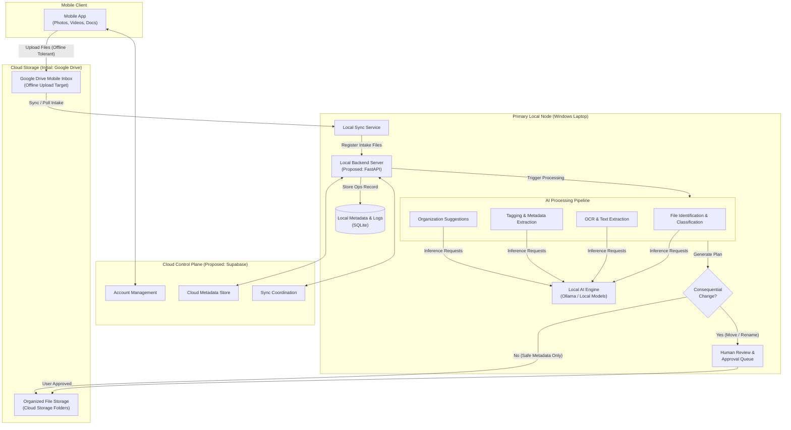

# SiloVault — High-Level Architecture

This document describes the proposed system architecture for **SiloVault**, outlining
the components, data topology, and structural boundaries.

For overall project scope, mission, and terminology, see
[PROJECT_OVERVIEW.md](PROJECT_OVERVIEW.md). For safety rules, see
[AGENTS.md](../AGENTS.md). For network and security considerations, see
[SECURITY.md](SECURITY.md).

---

## 1. Component Status Summary

To ensure clarity across all documentation, architecture elements are categorized by status:

| Status | Definition | Components |
|---|---|---|
| **Implemented** | Currently existing and active in repository | Documentation, project guidelines, `.gitignore`, FastAPI application skeleton with 14 registered routes, PWA frontend shell (6 views, service worker), test scaffolding (6 tests). All non-health endpoints are placeholder stubs. |
| **Planned** | Approved core requirement, design in progress | Primary Local Node, Mobile Inbox intake, AI Pipeline, Reversible storage rules |
| **Proposed** | Architectural choice under evaluation | FastAPI, SQLite, Ollama, Supabase for Cloud Control Plane, Google Drive API |
| **Future Possibility** | Concept for potential future extension | Additional cloud storage providers (S3/OneDrive), multi-device sync, local vector DB |

> [!NOTE]
> The application skeleton exists (FastAPI backend, PWA frontend, registered routes, tests) but contains no business logic, database models, cloud integrations, or AI processing. All backend, storage, and database selections remain proposed or planned.

---

## 2. High-Level System Architecture Diagram

---

## 3. Architecture Components Overview

### 3.1 Primary Local Node
* **Environment:** Windows laptop acting as the central processing unit for intelligence and local operations.
* **Backend Framework (Proposed):** `FastAPI` (Python) to manage local API routes, job scheduling, sync triggers, and workflow orchestration.
* **Local Storage & Index (Proposed):** `SQLite` database for maintaining local file metadata, operational histories, audit logs, and approval queues.
* **Local AI Engine (Proposed):** `Ollama` running locally on the Windows laptop for offline, private model execution (e.g., local LLMs and vision models). No AI request or file payload leaves the local machine over the internet.

### 3.2 Mobile Uploader
* **Interface:** Lightweight mobile application for capturing or selecting documents, photos, and videos.
* **Offline-Tolerant Direct Uploads:** Mobile uploads target a dedicated **Google Drive Mobile Inbox** folder. If the primary laptop is powered off or disconnected from the internet, mobile users can still upload files without interruption.
* **Asynchronous Ingestion:** Files sit safely in the mobile inbox until the Primary Local Node sync service comes online and processes them.

### 3.3 Cloud Control Plane (Proposed)
* **Technology Option (Proposed):** `Supabase` (or an equivalent lightweight backend-as-a-service) under evaluation for handling user identity/account management, cloud metadata synchronization, and cross-device status tracking.
* **Independence:** The Cloud Control Plane coordinates state and metadata only. It remains decoupled from physical file storage (Google Drive) so that metadata providers can be altered or migrated without disturbing stored files.

### 3.4 Cloud Storage Layer
* **Primary Provider (Proposed):** Google Drive API as the initial cloud storage integration target.
* **Modular Provider Architecture:** File operations (upload, list, move, copy, read) are designed behind an abstraction interface to support potential future cloud storage providers (such as S3 or OneDrive) without altering core processing logic.

### 3.5 AI Processing Pipeline
The AI processing pipeline executes locally and is structured into discrete stages:
1. **File Identification & Classification:** Detect file format, MIME type, structural properties, and target category (e.g., receipt, invoice, medical record, photo).
2. **OCR & Text Extraction:** Extract embedded text, scanned content, and document headers locally.
3. **Automatic Tagging & Metadata Extraction:** Generate contextual tags, creation dates, entities, and category metadata.
4. **Organization Suggestions & Approval:**
   - **Non-destructive / Metadata Changes:** Applied automatically or queued according to user rules.
   - **Consequential Changes (Moves, Renames, Deletions):** Placed into a Human Approval Queue. AI never executes irreversible file organization without explicit user consent.

### 3.6 Developer Collaboration Model
* **Repository:** Hosted on GitHub, serving as the single source of truth.
* **Team Structure:** Two co-developers working asynchronously on decoupled modules (e.g., local processing backend vs cloud sync integrations).
* **Integration Rule:** Developers must align on written documentation, data flow specifications, and API contracts prior to introducing new features or structural changes.

---

## 4. Key Architectural Guarantees

1. **Safety & Immutability:** Original files in the Google Drive Mobile Inbox or source directories remain unmodified until processing completes and human approval (where required) is logged.
2. **Privacy First:** Local AI node never exposes an inbound public network endpoint. Communication with cloud services is strictly outbound polling or authorized API client connections.
3. **Decoupled Architecture:** Storage providers, cloud metadata services, and local AI engines are connected via clear abstraction boundaries.
