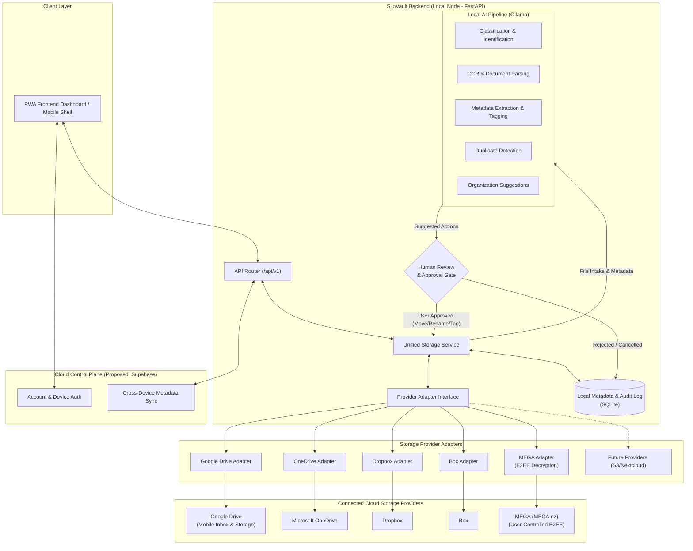

# SiloVault — High-Level Architecture

This document describes the proposed system architecture for **SiloVault**, outlining
the components, data topology, and structural boundaries.

For overall project scope, mission, and terminology, see
[PROJECT_OVERVIEW.md](PROJECT_OVERVIEW.md). For safety rules, see
[AGENTS.md](../AGENTS.md). For network and security considerations, see
[SECURITY.md](SECURITY.md).

---

## 1. Component Status Summary

To ensure clarity across all documentation, architecture elements are categorized by status:

| Status | Definition | Components |
|---|---|---|
| **Implemented** | Currently existing and active in repository | Documentation, project guidelines, `.gitignore`, FastAPI application skeleton with 14 registered routes, PWA frontend shell (6 views, service worker), test scaffolding (6 tests). All non-health endpoints are placeholder stubs. |
| **Planned** | Approved core requirement, design in progress | Primary Local Node, Unified Storage Service, Provider Adapter Interface, Google Drive Adapter, Mobile Inbox intake, AI Pipeline (Ollama), Human Review Queue, Reversible storage rules |
| **Proposed** | Architectural choice under evaluation | Multi-provider adapters (Microsoft OneDrive, Dropbox, Box, MEGA), SQLite local metadata, Supabase for Cloud Control Plane |
| **Future Possibility** | Concept for potential future extension | Additional storage providers (AWS S3, Nextcloud), multi-device sync, local vector DB / semantic search |

> [!NOTE]
> The application skeleton exists (FastAPI backend, PWA frontend, registered routes, tests) but contains no business logic, database models, cloud integrations, or AI processing. All backend, storage, adapter, and database selections remain proposed or planned.

---

## 2. High-Level Multi-Cloud System Architecture Diagram



---

## 3. Provider Adapter System Architecture

SiloVault operates as a **unified multi-cloud storage management platform**. Rather than hardcoding Google Drive or any single vendor into core business logic, all file operations pass through a provider-agnostic abstraction layer.

### 3.1 Layered Storage Topology

```
Frontend Dashboard (PWA)
         ↓
  SiloVault Backend API
         ↓
Unified Storage Service (Virtual file system, unified indexing, query routing)
         ↓
Provider Adapter Interface (Common abstract contract)
         ↓
┌───────────────┬───────────────┬───────────────┬───────────────┬───────────────┐
│ Google Drive  │   OneDrive    │    Dropbox    │      Box      │     MEGA      │
│    Adapter    │    Adapter    │    Adapter    │    Adapter    │    Adapter    │
└───────────────┴───────────────┴───────────────┴───────────────┴───────────────┘
```

1. **Frontend Dashboard:** Presents a single unified view of files, tags, and categories regardless of where files physically reside.
2. **Unified Storage Service:** Manages unified file indexing, cross-provider search, deduplication logic, virtual paths, and maps unified file IDs to specific provider accounts and native file IDs.
3. **Provider Adapter Interface:** Defines standard asynchronous methods that every cloud storage provider must implement.
4. **Concrete Provider Adapters:** Encapsulate provider-specific SDKs, HTTP protocols, authentication flows, pagination tokens, cryptographic operations, and error handling.

### 3.2 Provider Adapter Interface Contract

Every storage adapter must implement a common contract (e.g., `StorageAdapter` base class) with standardized signatures:

* **Connection & Authentication:**
  - `authenticate(credentials: dict) -> AuthState`: Initialize session, validate API keys/OAuth tokens, return connection validity.
  - `refresh_token() -> AuthState`: Refresh expired OAuth 2.0 access tokens securely.
  - `disconnect() -> bool`: Revoke session and securely clear in-memory tokens.
* **Navigation & Listing:**
  - `list_files(folder_id_or_path: str, cursor: str | None, page_size: int = 100) -> Page[ProviderFileRecord]`: List directory contents with pagination.
  - `get_metadata(provider_file_id: str) -> ProviderFileRecord`: Fetch comprehensive file metadata (size, MIME type, hashes, timestamps, permissions).
* **Transfer Operations:**
  - `download(provider_file_id: str) -> AsyncIterator[bytes]`: Stream file binary down to local temporary intake without storing indefinitely.
  - `upload(file_stream: AsyncIterator[bytes], destination_folder: str, filename: str, metadata: dict) -> ProviderFileRecord`: Stream file to destination, negotiating chunked or single-request upload based on file size.
* **File Management (Safe & Reversible):**
  - `rename(provider_file_id: str, new_name: str) -> ProviderFileRecord`: Rename file while preserving provider ID.
  - `move(provider_file_id: str, source_folder: str, target_folder: str) -> ProviderFileRecord`: Relocate file within provider storage hierarchy.
  - `delete(provider_file_id: str, permanent: bool = False) -> bool`: Move to trash/recycle bin by default; permanent deletion is **never executed by AI** and requires explicit human override.
* **Sync & Health:**
  - `check_sync_status() -> ProviderSyncStatus`: Poll rate limits, quota utilization, and connectivity status.
  - `get_delta(cursor: str | None) -> DeltaResult`: Query incremental changes since last sync cycle (where provider supports delta/change-tracking APIs).
  - `handle_error(error: Exception) -> NormalizedStorageError`: Map provider HTTP status codes (e.g., 429, 401, 404, 503) into standardized SiloVault error types (`RateLimitExceeded`, `AuthenticationFailed`, `FileNotFound`, `ProviderUnavailable`).

### 3.3 Provider Capability Model & Platform Differences

Not all cloud providers support identical features. SiloVault uses a capability negotiation model where adapters declare supported capabilities via feature flags:

| Capability / Attribute | Google Drive | Microsoft OneDrive | Dropbox | Box | MEGA (MEGA.nz) |
|---|---|---|---|---|---|
| **Primary Addressing** | ID-based (`fileId`) | ID-based & Path-based (`driveItem-id`) | Path-based primarily (supports ID) | ID-based (`file_id`) | Handle-based (8/11-char node handles) |
| **Resumable / Chunked Upload** | Resumable protocol (recommended >5 MB) | Upload session API (>4 MB required) | Upload session API (>150 MB required) | Chunked upload API (>20 MB required) | Chunked upload with client MAC *(Pending SDK investigation)* |
| **Delta / Change Tracking** | `Changes.list` API (page tokens) | `/delta` query on drive root | `/files/list_folder/continue` | `Events` API (enterprise/user stream) | Action packet stream *(Requires investigation)* |
| **Content Hash Algorithm** | MD5 checksum natively | `quickXorHash` & SHA-1 | Custom `dropbox-content-hash` | SHA-1 checksum natively | Chunk-based CBC-MAC / Encrypted hash *(Requires investigation)* |
| **Revisions / Versioning** | Yes (`Revisions.list`) | Yes (`driveItem/versions`) | Yes (`revisions/list`) | Yes (`file_version` resource) | Supported on account tier *(Pending investigation)* |
| **Search Capabilities** | Full-text query (`q` parameter) | Search query (`/search(q=...)`) | `/files/search_v2` | `/search` API with metadata filters | **Client-side only** (server has ciphertext only) |
| **Rate Limiting Strategy** | User/project quota per minute | Per-tenant request throttling (Retry-After) | Token bucket with 429 Retry-After | Sliding window with 429 Retry-After | Bandwidth/transfer quota limits *(Pending investigation)* |
| **Encryption Model** | Server-side / TLS in transit | Server-side / TLS in transit | Server-side / TLS in transit | Server-side / TLS in transit | **Client-side End-to-End Encryption (E2EE)** |

#### 3.3.1 Provider-Specific Characteristics: MEGA (MEGA.nz)

MEGA introduces unique architectural and cryptographic considerations fundamentally different from OAuth-based cloud providers:

1. **User-Controlled End-to-End Encryption (E2EE):**
   - MEGA employs a zero-knowledge encryption architecture. Files, directory structures, and file attributes are encrypted client-side before uploading.
   - *Unverified details:* Specific algorithm claims (e.g., AES-128 / AES-CTR, PBKDF2/scrypt key derivation, RSA key exchange) are based on prior public documentation and **require validation against the current official MEGA SDK** before being treated as design facts.
   - MEGA servers store only ciphertext, encrypted node keys, and cryptographic integrity MACs.
2. **Mandatory Client-Side Decryption for Processing:**
   - **SiloVault must never assume it can inspect cloud file contents on MEGA without obtaining the decrypted content through an authorized client-side workflow.**
   - Before local AI (Ollama), OCR, or metadata extraction can operate on a MEGA file, the `MegaAdapter` must download the ciphertext binary, decrypt it locally in an isolated sandbox using the user's decrypted node key, verify integrity, and only then pass the decrypted stream to local extraction routines.
3. **Authentication & Key Management Model:**
   - MEGA does not use standard OAuth 2.0 PKCE redirect flows.
   - Authentication relies on user credentials (email + password) to derive a master key via PBKDF2/scrypt, which in turn decrypts the user's RSA private key and session keys.
   - **Credential Handling:** SiloVault must never store raw user passwords on disk or in logs. The authentication flow must derive session credentials locally and store only encrypted session keys in the local OS credential store or encrypted local database. Exporting master keys to files or transmitting them outside the secure local boundary is strictly prohibited. Losing session keys means the user must re-authenticate; leaking them compromises the active MEGA session.
   - **Local-Only Key Protection:** Master keys and session credentials must be stored with extreme protection in the local OS credential store or encrypted local database; losing keys means unrecoverable loss of data, and leaking them compromises the entire MEGA account.
4. **Client-Side Search Limitation:**
   - Because MEGA servers have no access to plaintext filenames, folder names, or content, server-side keyword searching is impossible.
   - **Local Search Index:** All search, classification, and organization queries for MEGA must be executed locally against SiloVault's decrypted `UnifiedFileRecord` SQLite index. This is distinct from MEGA's own client-side search, which operates over decrypted metadata locally within the MEGA client and does not expose plaintext to MEGA servers. SiloVault must not assume MEGA client-side search results are accessible or compatible with its own local index; the two must be kept independent.
5. **Official SDK, API Approval & Licensing Restrictions:**
   - **Official SDK:** The reference client implementation is the official C++ MEGA SDK (`meganz/sdk`) and `MEGAcmd`, which provide cryptographic bindings.
   - **Licensing:** The official MEGA SDK is licensed under the **BSD 2-Clause "Simplified" License**. This is a permissive license that does not impose copyleft obligations on SiloVault's proprietary codebase. *Note:* MEGAcmd and any third-party dependencies bundled with the SDK may have their own licenses (e.g., AGPLv3 for some components) and must be audited individually before integration. Do not assume all MEGA-related components share the same license.
   - **Process Isolation (Optional):** While the BSD 2-Clause license does not legally require process isolation, running MEGA operations in a separate worker process or via a clean IPC boundary (e.g., CLI subprocess or separate micro-service) remains a recommended security and reliability design decision. Isolation limits the blast radius of SDK crashes, simplifies credential handling, and keeps the MEGA cryptographic boundary physically separate from SiloVault's core application code.
   - **API Key & Terms:** Production use of the MEGA API requires an authorized API key from MEGA Ltd. and adherence to MEGA's developer terms of service and bandwidth transfer quotas. Investigate MEGA application keys, developer terms, and approval requirements before public distribution.

**Adapter Handling Rules:**
- **Addressing:** SiloVault always records both `provider_file_id` (opaque string, such as a MEGA node handle or Google Drive fileId) and `path` (logical path) in its index.
- **Checksums:** Because cloud providers calculate native hashes differently (MD5, QuickXor, custom Dropbox hash, SHA-1, MEGA CBC-MAC), SiloVault computes a standard **SHA-256** checksum locally whenever a file binary is processed, ensuring universal deduplication across different cloud providers. **Note for MEGA:** The SHA-256 hash must be calculated over the *decrypted plaintext bytes* after local decryption. It must never be computed over ciphertext, encrypted node keys, or provider metadata, as this would produce a non-universal hash that cannot be matched across providers.
- **Rate Limit Resilience:** Adapters must respect provider `Retry-After` headers and implement exponential backoff with jitter.

### 3.4 Common Internal File Metadata Representation

All adapters map native provider payloads into a normalized `UnifiedFileRecord` stored in the local index:

```json
{
  "id": "file_uuid_9b1deb4d-3b7d-4bad-9bdd-2b0d7b3dcb6d",
  "provider": "GOOGLE_DRIVE",
  "provider_account_id": "acc_personal_gmail",
  "provider_file_id": "1A2B3C4D5E6F7G8H9I0J",
  "name": "2026-11-08_Medical_Receipt.pdf",
  "logical_path": "/Finances/2026/Receipts/2026-11-08_Medical_Receipt.pdf",
  "mime_type": "application/pdf",
  "size_bytes": 1048576,
  "sha256": "e3b0c44298fc1c149afbf4c8996fb92427ae41e4649b934ca495991b7852b855",
  "category": "Financial/Medical",
  "tags": ["#receipt", "#medical", "#2026"],
  "sync_state": "COMPLETED",
  "created_at": "2026-11-08T10:00:00Z",
  "modified_at": "2026-11-08T10:05:00Z",
  "provider_metadata": {
    "native_id": "1A2B3C4D5E6F7G8H9I0J",
    "web_view_link": "https://drive.google.com/file/d/...",
    "native_hash": "c02d4222c3c9d74404de4",
    "shared": false
  }
}
```

This ensures that UI, search, classification, and organization modules operate identically regardless of whether the underlying storage is Google Drive, OneDrive, Dropbox, Box, or MEGA.

---

## 4. Architecture Components Overview

### 4.1 Primary Local Node
* **Environment:** Windows laptop acting as the central processing unit for intelligence and local operations.
* **Backend Framework (Proposed):** `FastAPI` (Python) to manage local API routes, job scheduling, sync triggers, and workflow orchestration.
* **Local Storage & Index (Proposed):** `SQLite` database for maintaining unified file metadata, cross-provider operational histories, audit logs, and human approval queues.
* **Local AI Engine (Proposed):** `Ollama` running locally on the Windows laptop for offline, private model execution (e.g., local LLMs and vision models). No AI request or file payload leaves the local machine over the internet.

### 4.2 Unified Storage Service
* **Orchestration:** Sits between the API router and individual provider adapters.
* **Account Management:** Manages multiple connected storage accounts (e.g., multiple Google Drive accounts, personal OneDrive, work Dropbox).
* **Virtual Namespace:** Provides a unified browsing and search directory structure across multiple accounts.
* **Operation Logging & Rollback:** Intercepts move/rename operations to ensure reversible actions are recorded before execution.

### 4.3 Mobile Uploader & Cloud Inboxes
* **Interface:** Lightweight mobile PWA client for capturing or selecting documents, photos, and videos.
* **Offline-Tolerant Direct Uploads:** Mobile uploads target a dedicated cloud intake folder (e.g., Google Drive Mobile Inbox). If the primary laptop is powered off or disconnected from the internet, mobile users can still upload files without interruption.
* **Multi-Provider Intake (Planned):** Extensible to route mobile uploads to designated intake folders on any connected provider.
* **Asynchronous Ingestion:** Files sit safely in cloud inboxes until the Primary Local Node sync service comes online and processes them.

### 4.4 Cloud Control Plane (Proposed)
* **Technology Option (Proposed):** `Supabase` (or equivalent lightweight backend-as-a-service) under evaluation for user identity, cloud metadata synchronization, and cross-device status tracking.
* **Independence:** The Cloud Control Plane coordinates state and metadata only. It remains decoupled from physical file storage (Google Drive, OneDrive, Dropbox, Box, MEGA) so that metadata providers can be altered or migrated without disturbing stored files.

### 4.5 AI Processing Pipeline
The AI processing pipeline executes locally and is structured into discrete stages:
1. **File Identification & Classification:** Detect file format, MIME type, structural properties, and target category.
2. **OCR & Text Extraction:** Extract embedded text, scanned content, and document headers locally.
3. **Automatic Tagging & Metadata Extraction:** Generate contextual tags, creation dates, entities, and category metadata.
4. **Duplicate Detection:** Compare SHA-256 hashes against cross-provider index records.
5. **Organization Suggestions & Approval:**
   - **Non-destructive / Metadata Changes:** Applied automatically or queued according to user rules.
   - **Consequential Changes (Moves, Renames, Deletions):** Placed into a Human Approval Queue. AI never executes irreversible file organization without explicit user consent.

---

## 5. Key Architectural Guarantees

1. **Unified & Provider-Agnostic:** Business logic and AI pipelines never hardcode provider specifics; all interactions occur through the Provider Adapter Interface.
2. **Safety & Immutability:** Original files in cloud inboxes or source directories remain unmodified until processing completes and human approval (where required) is logged.
3. **Privacy by Default:** Local AI node never exposes an inbound public network endpoint. Ollama runs strictly on loopback (`127.0.0.1`).
4. **Credential Isolation:** OAuth client secrets and user access tokens are kept in encrypted local storage; credentials are never transmitted to frontend clients.
5. **Decoupled Multi-Cloud:** Storage providers, cloud metadata services, and local AI engines are connected via strict abstraction boundaries.
