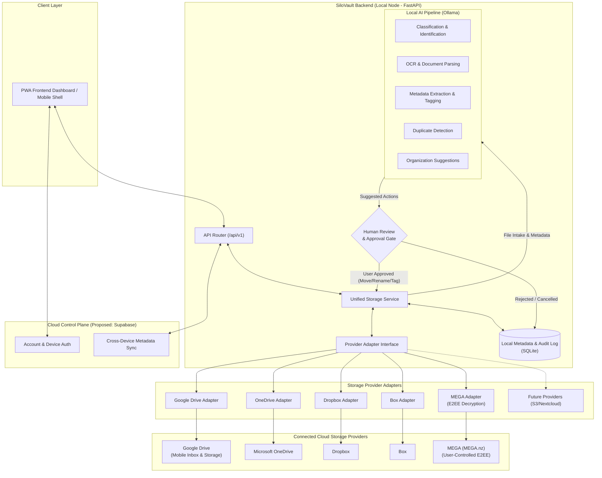

# SiloVault — High-Level Architecture

This document describes the proposed system architecture for **SiloVault**, outlining
the components, data topology, and structural boundaries.

For overall project scope, mission, and terminology, see
[PROJECT_OVERVIEW.md](PROJECT_OVERVIEW.md). For safety rules, see
[AGENTS.md](../AGENTS.md). For network and security considerations, see
[SECURITY.md](SECURITY.md).

---

## 1. Component Status Summary

To ensure clarity across all documentation, architecture elements are categorized by status:

| Status | Definition | Components |
|---|---|---|
| **Implemented** | Currently existing and active in repository | Documentation, project guidelines, `.gitignore`, FastAPI application skeleton, PWA frontend shell, SQLite database with Alembic migrations, `UnifiedFileRecord` model, local file operations (upload, list, detail, download, quarantine-based delete), plus rename and logical-move endpoints, activity history, Google Drive OAuth flow, storage adapter registry (LOCAL + GOOGLE_DRIVE), background deletion recovery service, account-scoped Google Drive OAuth, the HVSA H1.5.3 storage-account management API (list, detail, create, partial update) with cross-account isolation, HVSA H1.5.4 account-scoped file operations (download, rename, logical move, delete/quarantine, recovery and upload routed through the record's own storage account), and 1792 passing automated tests in the latest full run (3 skipped, 1 warning). M4.0 AI architecture planning is complete. M4.1 worker processing, proposal storage, and backend approval/rejection workflows are implemented and tested. M4.4 AI worker infrastructure (lease heartbeat, expired-lease recovery, processor registration, lifespan integration) is implemented and tested. The full AI pipeline, mobile uploader, approval workflow (frontend), and additional cloud-provider adapters remain incomplete. |
| **Planned** | Approved core requirement, design in progress | Unified Storage Service orchestration layer, OneDrive/Dropbox/Box Adapters, Mobile Inbox intake, AI Pipeline (Ollama), Human Review Queue, Reversible storage rules |
| **Proposed** | Architectural choice under evaluation | Multi-provider adapters (MEGA with E2EE), Supabase for Cloud Control Plane, Cross-device metadata sync |
| **Future Possibility** | Concept for potential future extension | Additional storage providers (AWS S3, Nextcloud), multi-device sync, local vector DB / semantic search |

> [!NOTE]
> M1 and M2 are complete; M3.1 and the current M3.2 implementation checkpoint are complete. The SQLite database, `UnifiedFileRecord`, Alembic-managed schema, local file operations, rename and logical-move APIs, Google Drive OAuth foundation, provider registry, and background deletion-recovery foundation are implemented. The HVSA H1.5.3 storage-account management API (list, detail, create, partial update) is implemented with server-generated credential references and cross-account isolation, and HVSA H1.5.4 routes download, rename, logical move, delete/quarantine, recovery and upload through the record's own storage account (§7.11). The latest full test run (26 November 2026) reported 1792 passed, 3 skipped, 0 failed, and 1 warning, with the preserved duplicate module `tests/test_m52_vision_runtime_new.py` excluded. Automated Google Drive tests use mocked services. Provider adapter capability must not be confused with API endpoint parity: the generic DELETE endpoint dispatches through the registered provider adapter — it is not LOCAL-only. Provider dispatch depends on a registered adapter — if an adapter is unavailable, the endpoint returns an appropriate unavailable response (HTTP 503). M4.0 architecture planning is complete. M4.1 worker processing, proposal storage, and backend approval/rejection workflows are implemented and tested. The full AI processing pipeline, mobile uploader, frontend approval workflow, and additional provider adapters remain incomplete.

---

## 2. High-Level Multi-Cloud System Architecture Diagram



---

## 3. Provider Adapter System Architecture

SiloVault operates as a **unified multi-cloud storage management platform**. Rather than hardcoding Google Drive or any single vendor into core business logic, all file operations pass through a provider-agnostic abstraction layer.

### 3.1 Layered Storage Topology

```
Frontend Dashboard (PWA)
         ↓
  SiloVault Backend API
         ↓
Unified Storage Service (Virtual file system, unified indexing, query routing)
         ↓
Provider Adapter Interface (Common abstract contract)
         ↓
┌───────────────┬───────────────┬───────────────┬───────────────┬───────────────┐
│ Google Drive  │   OneDrive    │    Dropbox    │      Box      │     MEGA      │
│    Adapter    │    Adapter    │    Adapter    │    Adapter    │    Adapter    │
└───────────────┴───────────────┴───────────────┴───────────────┴───────────────┘
```

1. **Frontend Dashboard:** Presents a single unified view of files, tags, and categories regardless of where files physically reside.
2. **Unified Storage Service:** Manages unified file indexing, cross-provider search, deduplication logic, virtual paths, and maps unified file IDs to specific provider accounts and native file IDs.
3. **Provider Adapter Interface:** Defines standard asynchronous methods that every cloud storage provider must implement.
4. **Concrete Provider Adapters:** Encapsulate provider-specific SDKs, HTTP protocols, authentication flows, pagination tokens, cryptographic operations, and error handling.

### 3.2 Provider Adapter Interface Contract

Every storage adapter must implement a common contract (e.g., `StorageAdapter` base class) with standardized signatures:

* **Connection & Authentication:**
  - `authenticate(credentials: dict) -> AuthState`: Initialize session, validate API keys/OAuth tokens, return connection validity.
  - `refresh_token() -> AuthState`: Refresh expired OAuth 2.0 access tokens securely.
  - `disconnect() -> bool`: Revoke session and securely clear in-memory tokens.
* **Navigation & Listing:**
  - `list_files(folder_id_or_path: str, cursor: str | None, page_size: int = 100) -> Page[ProviderFileRecord]`: List directory contents with pagination.
  - `get_metadata(provider_file_id: str) -> ProviderFileRecord`: Fetch comprehensive file metadata (size, MIME type, hashes, timestamps, permissions).
* **Transfer Operations:**
  - `download(provider_file_id: str) -> AsyncIterator[bytes]`: Stream file binary down to local temporary intake without storing indefinitely.
  - `upload(file_stream: AsyncIterator[bytes], destination_folder: str, filename: str, metadata: dict) -> ProviderFileRecord`: Stream file to destination, negotiating chunked or single-request upload based on file size.
* **File Management (Safe & Reversible):**
  - `rename(provider_file_id: str, new_name: str) -> ProviderFileRecord`: Rename file while preserving provider ID.
  - `move(provider_file_id: str, source_folder: str, target_folder: str) -> ProviderFileRecord`: Relocate file within provider storage hierarchy.
  - `delete(provider_file_id: str, permanent: bool = False) -> bool`: Move to trash/recycle bin by default; permanent deletion is **never executed by AI** and requires explicit human override.
* **Sync & Health:**
  - `check_sync_status() -> ProviderSyncStatus`: Poll rate limits, quota utilization, and connectivity status.
  - `get_delta(cursor: str | None) -> DeltaResult`: Query incremental changes since last sync cycle (where provider supports delta/change-tracking APIs).
  - `handle_error(error: Exception) -> NormalizedStorageError`: Map provider HTTP status codes (e.g., 429, 401, 404, 503) into standardized SiloVault error types (`RateLimitExceeded`, `AuthenticationFailed`, `FileNotFound`, `ProviderUnavailable`).

### 3.3 Provider Capability Model & Platform Differences

Not all cloud providers support identical features. SiloVault uses a capability negotiation model where adapters declare supported capabilities via feature flags:

| Capability / Attribute | Google Drive | Microsoft OneDrive | Dropbox | Box | MEGA (MEGA.nz) |
|---|---|---|---|---|---|
| **Primary Addressing** | ID-based (`fileId`) | ID-based & Path-based (`driveItem-id`) | Path-based primarily (supports ID) | ID-based (`file_id`) | Handle-based (8/11-char node handles) |
| **Resumable / Chunked Upload** | Resumable protocol (recommended >5 MB) | Upload session API (>4 MB required) | Upload session API (>150 MB required) | Chunked upload API (>20 MB required) | Chunked upload with client MAC *(Pending SDK investigation)* |
| **Delta / Change Tracking** | `Changes.list` API (page tokens) | `/delta` query on drive root | `/files/list_folder/continue` | `Events` API (enterprise/user stream) | Action packet stream *(Requires investigation)* |
| **Content Hash Algorithm** | MD5 checksum natively | `quickXorHash` & SHA-1 | Custom `dropbox-content-hash` | SHA-1 checksum natively | Chunk-based CBC-MAC / Encrypted hash *(Requires investigation)* |
| **Revisions / Versioning** | Yes (`Revisions.list`) | Yes (`driveItem/versions`) | Yes (`revisions/list`) | Yes (`file_version` resource) | Supported on account tier *(Pending investigation)* |
| **Search Capabilities** | Full-text query (`q` parameter) | Search query (`/search(q=...)`) | `/files/search_v2` | `/search` API with metadata filters | **Client-side only** (server has ciphertext only) |
| **Rate Limiting Strategy** | User/project quota per minute | Per-tenant request throttling (Retry-After) | Token bucket with 429 Retry-After | Sliding window with 429 Retry-After | Bandwidth/transfer quota limits *(Pending investigation)* |
| **Encryption Model** | Server-side / TLS in transit | Server-side / TLS in transit | Server-side / TLS in transit | Server-side / TLS in transit | **Client-side End-to-End Encryption (E2EE)** |

#### 3.3.1 Provider-Specific Characteristics: MEGA (MEGA.nz)

MEGA introduces unique architectural and cryptographic considerations fundamentally different from OAuth-based cloud providers:

1. **User-Controlled End-to-End Encryption (E2EE):**
   - MEGA employs a zero-knowledge encryption architecture. Files, directory structures, and file attributes are encrypted client-side before uploading.
   - *Unverified details:* Specific algorithm claims (e.g., AES-128 / AES-CTR, PBKDF2/scrypt key derivation, RSA key exchange) are based on prior public documentation and **require validation against the current official MEGA SDK** before being treated as design facts.
   - MEGA servers store only ciphertext, encrypted node keys, and cryptographic integrity MACs.
2. **Mandatory Client-Side Decryption for Processing:**
   - **SiloVault must never assume it can inspect cloud file contents on MEGA without obtaining the decrypted content through an authorized client-side workflow.**
   - Before local AI (Ollama), OCR, or metadata extraction can operate on a MEGA file, the `MegaAdapter` must download the ciphertext binary, decrypt it locally in an isolated sandbox using the user's decrypted node key, verify integrity, and only then pass the decrypted stream to local extraction routines.
3. **Authentication & Key Management Model:**
   - MEGA does not use standard OAuth 2.0 PKCE redirect flows.
   - Authentication relies on user credentials (email + password) to derive a master key via PBKDF2/scrypt, which in turn decrypts the user's RSA private key and session keys.
   - **Credential Handling:** SiloVault must never store raw user passwords on disk or in logs. The authentication flow must derive session credentials locally and store only encrypted session keys in the local OS credential store or encrypted local database. Exporting master keys to files or transmitting them outside the secure local boundary is strictly prohibited. Losing session keys means the user must re-authenticate; leaking them compromises the active MEGA session.
   - **Local-Only Key Protection:** Master keys and session credentials must be stored with extreme protection in the local OS credential store or encrypted local database; losing keys means unrecoverable loss of data, and leaking them compromises the entire MEGA account.
4. **Client-Side Search Limitation:**
   - Because MEGA servers have no access to plaintext filenames, folder names, or content, server-side keyword searching is impossible.
   - **Local Search Index:** All search, classification, and organization queries for MEGA must be executed locally against SiloVault's decrypted `UnifiedFileRecord` SQLite index. This is distinct from MEGA's own client-side search, which operates over decrypted metadata locally within the MEGA client and does not expose plaintext to MEGA servers. SiloVault must not assume MEGA client-side search results are accessible or compatible with its own local index; the two must be kept independent.
5. **Official SDK, API Approval & Licensing Restrictions:**
   - **Official SDK:** The reference client implementation is the official C++ MEGA SDK (`meganz/sdk`) and `MEGAcmd`, which provide cryptographic bindings.
   - **Licensing:** The official MEGA SDK is licensed under the **BSD 2-Clause "Simplified" License**. This is a permissive license that does not impose copyleft obligations on SiloVault's proprietary codebase. *Note:* MEGAcmd and any third-party dependencies bundled with the SDK may have their own licenses (e.g., AGPLv3 for some components) and must be audited individually before integration. Do not assume all MEGA-related components share the same license.
   - **Process Isolation (Optional):** While the BSD 2-Clause license does not legally require process isolation, running MEGA operations in a separate worker process or via a clean IPC boundary (e.g., CLI subprocess or separate micro-service) remains a recommended security and reliability design decision. Isolation limits the blast radius of SDK crashes, simplifies credential handling, and keeps the MEGA cryptographic boundary physically separate from SiloVault's core application code.
   - **API Key & Terms:** Production use of the MEGA API requires an authorized API key from MEGA Ltd. and adherence to MEGA's developer terms of service and bandwidth transfer quotas. Investigate MEGA application keys, developer terms, and approval requirements before public distribution.

**Adapter Handling Rules:**
- **Addressing:** SiloVault always records both `provider_file_id` (opaque string, such as a MEGA node handle or Google Drive fileId) and `path` (logical path) in its index.
- **Checksums:** Because cloud providers calculate native hashes differently (MD5, QuickXor, custom Dropbox hash, SHA-1, MEGA CBC-MAC), SiloVault computes a standard **SHA-256** checksum locally whenever a file binary is processed, ensuring universal deduplication across different cloud providers. **Note for MEGA:** The SHA-256 hash must be calculated over the *decrypted plaintext bytes* after local decryption. It must never be computed over ciphertext, encrypted node keys, or provider metadata, as this would produce a non-universal hash that cannot be matched across providers.
- **Rate Limit Resilience:** Adapters must respect provider `Retry-After` headers and implement exponential backoff with jitter.

### 3.4 Common Internal File Metadata Representation

All adapters map native provider payloads into a normalized `UnifiedFileRecord` stored in the local index:

```json
{
  "id": "file_uuid_9b1deb4d-3b7d-4bad-9bdd-2b0d7b3dcb6d",
  "provider": "GOOGLE_DRIVE",
  "provider_account_id": "acc_personal_gmail",
  "provider_file_id": "1A2B3C4D5E6F7G8H9I0J",
  "name": "2026-11-08_Medical_Receipt.pdf",
  "logical_path": "/Finances/2026/Receipts/2026-11-08_Medical_Receipt.pdf",
  "mime_type": "application/pdf",
  "size_bytes": 1048576,
  "sha256": "e3b0c44298fc1c149afbf4c8996fb92427ae41e4649b934ca495991b7852b855",
  "category": "Financial/Medical",
  "tags": ["#receipt", "#medical", "#2026"],
  "sync_state": "COMPLETED",
  "created_at": "2026-11-08T10:00:00Z",
  "modified_at": "2026-11-08T10:05:00Z",
  "provider_metadata": {
    "native_id": "1A2B3C4D5E6F7G8H9I0J",
    "web_view_link": "https://drive.google.com/file/d/...",
    "native_hash": "c02d4222c3c9d74404de4",
    "shared": false
  }
}
```

This ensures that UI, search, classification, and organization modules operate identically regardless of whether the underlying storage is Google Drive, OneDrive, Dropbox, Box, or MEGA.

---

## 4. Architecture Components Overview

### 4.1 Primary Local Node
* **Environment:** Windows laptop acting as the central processing unit for intelligence and local operations.
* **Backend Framework (Proposed):** `FastAPI` (Python) to manage local API routes, job scheduling, sync triggers, and workflow orchestration.
* **Local Storage & Index (Proposed):** `SQLite` database for maintaining unified file metadata, cross-provider operational histories, audit logs, and human approval queues.
* **Local AI Engine (Proposed):** `Ollama` running locally on the Windows laptop for offline, private model execution (e.g., local LLMs and vision models). No AI request or file payload leaves the local machine over the internet.

### 4.2 Unified Storage Service
* **Orchestration:** Sits between the API router and individual provider adapters.
* **Account Management:** Manages multiple connected storage accounts (e.g., multiple Google Drive accounts, personal OneDrive, work Dropbox). The implemented storage-account CRUD API, credential references, and cache isolation are documented in §7.10.
* **Virtual Namespace:** Provides a unified browsing and search directory structure across multiple accounts.
* **Operation Logging & Rollback:** Intercepts move/rename operations to ensure reversible actions are recorded before execution.

### 4.3 Mobile Uploader & Cloud Inboxes
* **Interface:** Lightweight mobile PWA client for capturing or selecting documents, photos, and videos.
* **Offline-Tolerant Direct Uploads:** Mobile uploads target a dedicated cloud intake folder (e.g., Google Drive Mobile Inbox). If the primary laptop is powered off or disconnected from the internet, mobile users can still upload files without interruption.
* **Multi-Provider Intake (Planned):** Extensible to route mobile uploads to designated intake folders on any connected provider.
* **Asynchronous Ingestion:** Files sit safely in cloud inboxes until the Primary Local Node sync service comes online and processes them.

### 4.4 Cloud Control Plane (Proposed)
* **Technology Option (Proposed):** `Supabase` (or equivalent lightweight backend-as-a-service) under evaluation for user identity, cloud metadata synchronization, and cross-device status tracking.
* **Independence:** The Cloud Control Plane coordinates state and metadata only. It remains decoupled from physical file storage (Google Drive, OneDrive, Dropbox, Box, MEGA) so that metadata providers can be altered or migrated without disturbing stored files.

### 4.5 AI Processing Pipeline
The AI processing pipeline executes locally and is structured into discrete stages:
1. **File Identification & Classification:** Detect file format, MIME type, structural properties, and target category.
2. **OCR & Text Extraction:** Extract embedded text, scanned content, and document headers locally.
3. **Automatic Tagging & Metadata Extraction:** Generate contextual tags, creation dates, entities, and category metadata.
4. **Duplicate Detection:** Compare SHA-256 hashes against cross-provider index records.
5. **Organization Suggestions & Approval:**
   - **Non-destructive / Metadata Changes:** Applied automatically or queued according to user rules.
   - **Consequential Changes (Moves, Renames, Deletions):** Placed into a Human Approval Queue. AI never executes irreversible file organization without explicit user consent.

---

## 5. Key Architectural Guarantees

1. **Unified & Provider-Agnostic:** Business logic and AI pipelines never hardcode provider specifics; all interactions occur through the Provider Adapter Interface.
2. **Safety & Immutability:** Original files in cloud inboxes or source directories remain unmodified until processing completes and human approval (where required) is logged.
3. **Privacy by Default:** Local AI node never exposes an inbound public network endpoint. Ollama runs strictly on loopback (`127.0.0.1`).
4. **Credential Isolation:** OAuth client secrets and user access tokens are kept in encrypted local storage; credentials are never transmitted to frontend clients.
5. **Decoupled Multi-Cloud:** Storage providers, cloud metadata services, and local AI engines are connected via strict abstraction boundaries.

## 6. Database Schema Management (Alembic)

**Status: Implemented**

The local SQLite metadata database is managed with **Alembic** for version-controlled schema migrations.

### Design decisions

- **Single source of truth for the database path.** Both the FastAPI application (`backend/config.py` → `settings.database_url`) and Alembic (`alembic/env.py`) resolve the database URL from the same `DATABASE_PATH` setting. There is no second, hardcoded path in `alembic.ini`; the `sqlalchemy.url` entry there is only a placeholder.
- **Explicit, never automatic.** Application startup (`backend/main.py` lifespan) does **not** run Alembic migrations. `init_db()` in `backend/database.py` still calls `Base.metadata.create_all()`, which is idempotent and only creates missing tables for first-run setups — it never alters existing schemas. All schema changes to an existing database go through `alembic upgrade head`, run explicitly by a developer after reviewing the migration.
- **Model registration contract.** `alembic/env.py` imports `backend.database.Base` and `backend.models` before assigning `target_metadata`, so autogenerate sees every registered table, index (including the partial unique `uq_local_provider_file`), and the custom `UTCDateTime` type decorator.
- **SQLite compatibility.** `env.py` sets `render_as_batch=True` (required for SQLite constraint/index changes) and mirrors the application's WAL mode and busy-timeout pragmas on the migration connection.

### Migration layout

```
alembic.ini                    # Alembic configuration (URL is a placeholder; env.py resolves it)
alembic/
├── env.py                     # Imports app settings + Base.metadata; runs migrations
├── script.py.mako             # Template for new revision scripts
└── versions/
    ├── b436c12118f9_create_unified_file_records_baseline.py   # baseline migration
    ├── ...                                                    # later schema revisions
    └── 20261125120000_h1_5_3_credentials_ref_trimmed_unique.py # current head (b7c4e1a92f30)
```

### Current state

- Baseline revision `b436c12118f9` represents the `UnifiedFileRecord` schema as of M1.
- The existing development database was verified schema-identical to the baseline and **stamped** (no DDL executed) at `b436c12118f9`; existing records were preserved.
- The current head is `b7c4e1a92f30` (`20261125120000_h1_5_3_credentials_ref_trimmed_unique.py`), which creates the migration-owned partial unique expression index `uq_storage_accounts_credentials_ref_trimmed` on `trim(credentials_ref, char(9,10,11,12,13,32)) WHERE credentials_ref IS NOT NULL`. Exactly one head exists.
- The index is intentionally **not** declared in model metadata: SQLite reflection skips expression indexes, so declaring it would make autogenerate attempt to recreate it. Alembic owns the index.

### Commands

| Command | Purpose |
|---|---|
| `alembic current` | Show the live database's current revision |
| `alembic history` | Show the full migration history |
| `alembic upgrade head` | Apply all pending migrations (run explicitly, after backup) |
| `alembic revision --autogenerate -m "msg"` | Scaffold a new migration from model changes |
| `alembic downgrade -1` | Revert one migration (local testing only) |

See [README.md](../README.md#database-migrations-alembic) for the full developer workflow, including the temporary-database pattern for safe autogenerate and testing.

## 7. M3.2 Implementation (Google Drive Integration & File Management)

**Status: Implemented through the current M3.2 checkpoint; M4.0 complete and M4.1 in progress**

The current storage, Google Drive, storage-account and account-scoped file-operation work is covered by the latest full suite (1792 passed, 3 skipped, 0 failed, 1 warning). M4.0 planning is complete. M4.1 worker processing, proposal storage, and backend approval/rejection workflows are implemented and tested; actual AI processing capabilities remain unfinished. This section documents implemented behavior and calls out remaining API limitations explicitly.

### 7.1 Google Drive OAuth and Credential Management

- **Endpoints:** `POST /api/v1/google-drive/connect`, `GET /api/v1/google-drive/status`, `DELETE /api/v1/google-drive/disconnect`.
- **Flow:** Installed-app loopback OAuth with PKCE. A local callback server on a random port receives the authorization code; the code is exchanged for a refresh token.
- **Credential storage:** Only the refresh token (plus granted scopes and the discovered SiloVault root folder ID) is persisted, in the **OS keyring** (Windows Credential Manager / macOS Keychain / Linux Secret Service) via the `keyring` library. Access tokens are kept in memory only and are never written to disk or logs.
- **Scope configuration:** Configured via `GOOGLE_DRIVE_CLIENT_ID` / `GOOGLE_DRIVE_CLIENT_SECRET` environment variables (see `.env.example`); scopes come from `settings.google_drive_scopes_list`.
- **Security:** OAuth callback query strings (which contain the authorization code) are suppressed from request logging. Secrets are never included in API responses. On authentication failure during connect, stored credentials are cleaned up.
- **Startup restoration:** On application startup the backend attempts to restore the Google Drive connection from stored credentials (best-effort; failures do not block startup, and the LOCAL adapter always operates).

#### Account-scoped credentials (HVSA H1.4C)

- **Per-account keyring entries:** The credential helpers in `backend/storage/credentials.py` accept an optional `credentials_ref`. When supplied, the keyring *account* name is a SHA-256 digest of that reference, so each `StorageAccount` reads and writes its own entry. When `credentials_ref` is `None` the legacy `"google-drive"` entry is used unchanged.
- **Adapter scoping:** `GoogleDriveAdapter(credentials=..., credentials_ref=...)` scopes both credential loads/stores and SiloVault root-folder persistence to that reference. A scoped adapter never reads or writes the legacy entry, and two accounts therefore cannot see each other's refresh token or root-folder ID.
- **Factory wiring:** `AdapterFactory` passes `StorageAccount.credentials_ref` to the created Google Drive adapter, so adapters built for different accounts are isolated even though they use the same provider. Adapter construction still performs no database access and no authentication.
- **Disconnect:** `GoogleDriveAdapter.disconnect()` clears in-memory state only; it never deletes keyring entries, so disconnecting one account cannot remove another account's credentials.
- **Legacy HTTP endpoints:** `POST /api/v1/google-drive/connect`, `GET /api/v1/google-drive/status` and `DELETE /api/v1/google-drive/disconnect` continue to operate on the single legacy `"google-drive"` entry exactly as before. They are unaffected by, and never touch, managed-account credentials.

#### Account-scoped OAuth endpoints (HVSA H1.4D)

- **Endpoints (managed accounts only):**
  - `POST /api/v1/storage-accounts/{account_id}/google-drive/connect`
  - `GET /api/v1/storage-accounts/{account_id}/google-drive/status`
  - `DELETE /api/v1/storage-accounts/{account_id}/google-drive/disconnect`
- **Account validation:** The account must exist (`404` otherwise) and must have `provider_id == "GOOGLE_DRIVE"`. `LOCAL` accounts and every other provider are rejected with `400`; provider IDs and account IDs are never treated as interchangeable.
- **Credential reference:** The server resolves `StorageAccount.credentials_ref`. If the record has none yet, a server-generated reference is persisted through `AccountManager` before the flow starts, so a client can never choose another account's reference. The OAuth backfill uses the deterministic `storage-account:<account id>` form; accounts created through `POST /api/v1/storage-accounts` instead receive `storage-account:<uuid4>` from the create endpoint. No schema change is required — the column already exists.
- **Connect:** Runs the same installed-app loopback OAuth flow (PKCE plus `state` validation) as the legacy endpoint, through `_run_oauth_flow(credentials_ref=..., promote_to=...)`. The token is written to a per-attempt staging entry, authenticated, and only then promoted into that account's permanent keyring entry (HVSA H1.4F); the returned adapter is scoped to the permanent reference, so SiloVault root-folder state is isolated too. On success the account status becomes `"connected"`. On `state_mismatch`, timeout, missing refresh token, or exchange/authentication failure the account record is left unchanged, only this attempt's staging entry is removed, and any previously stored credential for the account survives untouched.
- **Callback binding:** The account identity never travels through the OAuth callback. The callback is validated by the existing `state` mechanism and the account binding comes from the server-side request path, so a callback cannot be replayed against, or reassigned to, another account.
- **Status:** Returns `account_id`, `provider_id`, `display_name`, `status`, `connected`, `credentials_present` and `adapter_present` only. It reads this account's keyring entry (never the legacy entry) and performs no provider call. Tokens, credential objects, and client secrets are never returned. `status` is the persisted database value (reported as `disconnected` when this account's own credential entry is gone); `adapter_present` says whether an authenticated in-memory adapter for this account is installed (the legacy adapter never counts); `connected` is the runtime answer and is true only when the database says `connected`, the credentials exist, and the managed adapter is installed.
- **Disconnect:** Deletes only `delete_google_drive_credentials(credentials_ref=account.credentials_ref)`, drops that account's in-memory adapter, and marks the account `"disconnected"`. It never calls the legacy no-argument deletion, never removes the `StorageAccount` record, never touches Drive files, and is idempotent on repeat.
- **Provider registry:** Managed adapters are kept in an in-memory per-account map and are deliberately **not** registered under the provider-level `"GOOGLE_DRIVE"` registry key, which stays reserved for the legacy connection. Dispatching business endpoints to a specific managed account remained out of scope for H1.4D and was implemented later in HVSA H1.5.4 (§7.11).
- **Credential-reference integrity (HVSA H1.4E-A):** `AccountManager` validates every `credentials_ref` before storing it: references are trimmed, empty/whitespace-only values and values longer than the column are rejected, and a reference already used by a *different* account is refused on both create and update (an account may always keep its own reference). Collision detection is a service-layer scan over trimmed values, so rows written before this validation still count. Uniqueness is enforced twice: the service-layer scan above and, since HVSA H1.5.3, a migration-owned partial unique expression index `uq_storage_accounts_credentials_ref_trimmed` on `trim(credentials_ref, char(9,10,11,12,13,32)) WHERE credentials_ref IS NOT NULL`. The index covers the ASCII whitespace set (space, TAB, LF, VT, FF, CR) because SQLite's one-argument `trim()` strips only spaces; Unicode whitespace such as U+00A0 is **not** covered by the index, and Python `str.strip()` in `AccountManager` remains the authoritative check for those variants. The migration aborts instead of rewriting data if normalized duplicates already exist.
- **Database uniqueness (HVSA H1.4F, resolved by H1.5.3):** The scan-then-insert check in `AccountManager` is not atomic on its own, so two truly simultaneous account creations with the same reference could both pass validation. The migration-owned partial unique expression index described above now provides the database-level guarantee; it was added together with the account CRUD API. The service-layer validation remains in place because it produces clear 409 responses and still detects whitespace variants in rows written before the validation existed; it must not be removed.
- **Staged credential replacement (HVSA H1.4F):** A managed connect never writes straight into the account's permanent entry. Each attempt gets a unique staging reference (`<permanent ref>:staging:<uuid4 hex>`) that exists only in the current keyring write, is never persisted in the database, never returned to a client, and never logged. The sequence is *stage → authenticate → promote*: on success the credential is written to the permanent entry and the staging entry is deleted; on any failure only the staging entry is deleted. The keyring has no atomic rename, so promotion is a second `set_password`; if that write fails the previous permanent value stands and only the staging entry is removed. A failed reconnect — invalid credentials, provider outage, or a failed promotion — therefore always leaves the previously working credential intact.
- **Cleanup ownership (HVSA H1.4F):** Every failure path cleans up by the reference the operation itself wrote, so cleanup can only remove that attempt's staging entry. It never removes another account's entry (references are otherwise unique), never removes the permanent entry, and never removes the legacy `"google-drive"` entry (`_discard_scoped_credentials(None)` is a no-op by design). Cleanup is best-effort: a locked keyring (`CredentialStorageError`) or an unexpected backend error such as `OSError` is swallowed and only the exception type is logged, so it can never replace the original authentication/provider failure or turn a failed connect into a success.
- **Status-persistence failure (HVSA H1.4F):** If the status commit fails after a successful exchange, the session is rolled back and the adapter is not installed, so an account never reports usable while its status was not persisted. The newly promoted credential is retained (it authenticated successfully and belongs to this account) while the attempt's staging entry is removed. Cleanup uses the account ID captured before the rollback, so error handling never reads ORM attributes that rollback may have expired or detached.
- **Concurrency (HVSA H1.4E-A / H1.4F):** Connect and disconnect hold a narrow per-account lock for the whole operation (configured through a reference-counted lock map that drops idle entries). Same-account operations are serialized — a later connect cannot have its token deleted by an earlier failed one, and a disconnect waits for an in-flight connect — while different accounts proceed independently. The reference is taken before the wait and always returned in `finally` (including when acquisition is interrupted), and an entry is deleted only when its count reaches zero **and** the map still holds the exact entry the caller registered. One interruption window is documented rather than engineered around: a `KeyboardInterrupt` delivered between `lock.acquire()` returning and the internal flag being set would leave that lock held. Status reads take no lock. Because the route handlers are synchronous, blocking on this lock never stalls the event loop.
- **Restart reconciliation (HVSA H1.4E-B):** Startup calls `restore_managed_adapters(session_factory)` from the application lifespan, after the legacy Google Drive restoration and before the recovery service and AI worker start. It reads a snapshot of managed `GOOGLE_DRIVE` accounts whose status is `connected` and that have a credential reference in one short-lived session, then rebuilds each adapter independently from that account's own scoped keyring entry and installs it in the per-account map (never in the provider registry, never replacing the legacy adapter). The sweep runs in a worker thread and is best-effort: one account's failure never blocks startup or the remaining accounts.
- **Restart failure classification (HVSA H1.4E-B):** Successful authentication installs the adapter and leaves status and credentials untouched. `StorageAuthenticationError` installs nothing, marks the account `disconnected`, and **preserves** the keyring entry so the user can reconnect. `StorageUnavailableError` (transient provider failure) and `CredentialStorageError` (locked/unavailable keyring) install nothing but preserve both status and credentials. A missing scoped credential entry installs nothing and marks the account `disconnected`; the legacy entry is never used as a fallback. Reconciliation never deletes credentials.

### 7.2 Storage Adapter and Provider Registry

- **Interface:** `StorageOperations` (abstract) defines the mandatory operations: `upload`, `download`, `rename`, `move`, `quarantine`, `restore`, `cleanup`. `StorageLifecycle` (optional) adds `authenticate`, `refresh`, `disconnect` for cloud providers; `LocalAdapter` deliberately does not implement it.
- **Registry:** Adapters are registered under canonical provider IDs (`LOCAL`, `GOOGLE_DRIVE`) during application lifespan setup via `register(provider_id, adapter, capabilities)`. The registry serves **legacy/provider-level** records only: a record whose `provider_account_id` is `NULL` dispatches through `lookup(provider_id)`, and a record that names a managed storage account resolves through `resolve_file_adapter()` instead (§7.11). Unknown providers raise `StorageUnavailableError` (mapped to HTTP 503).
- **Google Drive adapter:** `GoogleDriveAdapter` implements all seven `StorageOperations` methods plus the lifecycle hooks. It manages a dedicated "SiloVault" root folder (discovered or created, with the folder ID persisted to the keyring). All Drive API `HttpError`s are mapped to the SiloVault storage error hierarchy (404 → not found, 403 → permission, 429/403 rate-limit → rate limit, 413 → quota, 5xx → unavailable).

### 7.3 Upload and Download Integration

- **Upload:** `POST /api/v1/uploads` accepts a `provider` query parameter (default `LOCAL`) and an optional `account_id`. Without `account_id` the request dispatches through the registry exactly as before (legacy, `provider_account_id` stays `NULL`). With `account_id` the request resolves that exact managed account through `resolve_file_adapter()`, the account's provider must match `provider`, and the ID is persisted as the new record's `provider_account_id`. Empty or whitespace-only `account_id` is rejected with `422`; an unknown account is `404`, a provider mismatch `409`, and a disconnected or unavailable account `503` (§7.11). For GOOGLE_DRIVE, files are uploaded to the SiloVault root folder via resumable upload.
- **Download:** `GET /api/v1/files/{file_id}/download` resolves its adapter with `resolve_file_adapter()`: a legacy record (`provider_account_id` `NULL`) dispatches through `lookup(record.provider)`, a managed record resolves exactly its own storage account (§7.11). The client-supplied `file_id` resolves only a database row, and the provider-assigned identifier is passed verbatim to the adapter.
- **Listing/Detail:** `GET /api/v1/files` and `GET /api/v1/files/{file_id}` serve from the unified metadata database regardless of provider.

### 7.4 Deletion and Recovery Workflow

- **Endpoint:** `DELETE /api/v1/files/{file_id}` resolves its adapter with `resolve_file_adapter()` — legacy records through the registered provider adapter, managed records through exactly their own storage account (§7.11) — and the same resolved instance performs quarantine, rollback restoration and cleanup. For LOCAL records, quarantine-based deletion with recovery is performed. For GOOGLE_DRIVE, the generic endpoint dispatches through the registered Google Drive adapter and its quarantine/cleanup workflow is covered by mocked tests. Live Google Drive verification remains outstanding, and this does not establish deletion parity for other cloud providers. If an adapter is unavailable, the endpoint returns HTTP 503.
- **Protocol:** Three-phase transaction — (1) quarantine the physical file, (2) delete the metadata record and write a durable `PendingDeletion` row in the same transaction, (3a) on commit success, run physical cleanup; (3b) on commit failure, restore the quarantined file so nothing is lost. The `PendingDeletion` row stores the deleted record's `provider_account_id` (`NULL` for legacy records), so cleanup and any RESTORE row created by a failed rollback resolve the same account.
- **Recovery service:** A background worker (plus a one-shot startup pass) processes `PendingDeletion` records. Each claimed record's adapter is resolved with `resolve_file_adapter()`; an unknown account, a provider mismatch, a disconnected account or an unavailable credential store schedules a transient retry with the row and its ownership intact, and is never treated as a missing file. It uses claim tokens and leases (5-minute lease, renewed by a heartbeat while cleanup runs) to coordinate ownership between the API and the worker, with exponential-backoff retries (up to 5) before a record is marked `FAILED`.
- **Known limitations (do not overstate the safety guarantees):**
  - The lease/claim mechanism provides a strong ownership convention at the database level, but it is **not** a perfectly concurrency-safe guarantee in the distributed-systems sense: if a process is hard-killed (e.g., power loss) while a physical cleanup is in flight, a second worker can claim the record after the lease expires and re-run cleanup. Cleanup is written to be idempotent (an already-absent resource is treated as success), which is the practical mitigation.
  - The heartbeat thread uses a 10-second join timeout; if it has not stopped, finalization and retry scheduling are skipped and the record is left for recovery after lease expiry.
  - **Heartbeat identity (HVSA H1.5.4 Step 7):** The `PendingDeletion` primary key is assigned before the delete transaction commits and held as a plain string. The heartbeat thread, the conditional finalize/retry statements and every log call use that scalar, so no code path reads attributes from the request-session ORM instance after `commit()` expires it. This removes the cross-thread refresh that could raise `ObjectDeletedError` (and surface as HTTP 500) when cleanup outlived a heartbeat tick.
  - The generic `DELETE /api/v1/files/{file_id}` endpoint dispatches through the registered provider adapter; it is not LOCAL-only. Google Drive deletion through this endpoint is implemented and covered by mocked adapter tests, but must not be described as live-provider verified. Other cloud providers still require their own implementation and verification.
  - A complete user-facing restore workflow is not implemented. The RESTORE recovery operation is a failure-recovery foundation, not a general restore UI/API.

### 7.5 File Rename API

- **Endpoint:** `PATCH /api/v1/files/{file_id}/rename` with body `{"new_name": "..."}` (1–255 characters, whitespace-only rejected).
- **Dispatch:** Provider-neutral via `resolve_file_adapter()` — a legacy record uses `lookup(record.provider)`, a managed record uses exactly its own storage account, and a managed-account failure never falls back to the registry (§7.11); supports LOCAL and GOOGLE_DRIVE.
- **Behavior:**
  - **LOCAL:** The physical storage filename (server-generated UUID) is **not** changed. Only the user-facing `name` in the database is updated.
  - **GOOGLE_DRIVE:** The **actual Google Drive filename is changed** via the Drive API (`files().update` with the new name).
- **Safety:** The adapter is called before any database change; the returned provider record's `provider_file_id` must match the database record before the update is committed. Only `name` and `updated_at` are modified; all other metadata is preserved. A successful rename is recorded in the activity log (`RENAME`).

### 7.6 Logical Move API

- **Endpoint:** `PATCH /api/v1/files/{file_id}/move` with body `{"target_logical_path": "..."}` (1–1024 characters, whitespace-only rejected).
- **Dispatch:** Provider-neutral via `resolve_file_adapter()` — a legacy record uses `lookup(record.provider)`, a managed record uses exactly its own storage account, and a managed-account failure never falls back to the registry (§7.11); supports LOCAL and GOOGLE_DRIVE.
- **Behavior:**
  - **LOCAL:** The physical file stays in place; only the `logical_path` in the database is updated. Local storage keeps its existing flat physical file organization.
  - **GOOGLE_DRIVE:** This is a **logical organization operation only** — SiloVault's `logical_path` is updated, but the **Google Drive parent folder is not changed**. The file remains in its original Drive location.
- **Safety:** Same pattern as rename — adapter call before database change, provider-record validation, only `logical_path` and `updated_at` modified, activity logged (`MOVE`).

### 7.7 Verification Status

- The latest full automated test run (26 November 2026) reported **1792 passed, 3 skipped, 0 failed, 1 warning**, with the preserved duplicate module `tests/test_m52_vision_runtime_new.py` excluded. The single warning is the Starlette deprecation for `HTTP_422_UNPROCESSABLE_ENTITY` (replacement: `HTTP_422_UNPROCESSABLE_CONTENT`). Google Drive automated tests use mocked Drive API services and a fake keyring. Treat manual smoke checks and mocked automated tests as different evidence; neither alone constitutes production readiness. The generic DELETE endpoint dispatches through the registered provider adapter — it is not LOCAL-only at this checkpoint, even though the Google Drive adapter and recovery abstractions contain provider-level functionality.

### 7.8 M3.2 Stage A — Database Foundation (Implemented)

The database schema has been extended to support file restoration and recovery worker fencing.

- **Snapshot Columns:** Seven nullable columns (`original_file_id`, `original_logical_path`, `original_mime_type`, `original_size_bytes`, `original_sha256`, `original_category`, `original_tags`) added to `pending_deletions` to preserve file state at the moment of deletion.
- **Concurrency Fencing:** `operation_generation` (Integer, non-null, default 0) added to prevent "zombie workers" from executing stale operations.
- **Status Expansion:** The `status` column length increased to 32 characters to accommodate new lifecycle states.
- **SQLite Compatibility:** All changes implemented using Alembic batch operations to ensure safe schema modification on SQLite.
- **Isolation:** Migration tests use temporary database files (controlled via `DATABASE_PATH`) to ensure the production database is never modified during testing.

### 7.9 M4.4 — AI Task Lease Heartbeat and Expired-Lease Recovery (Implemented)

The AI worker (`backend/services/ai_worker.py`) claims `ai_tasks` rows with a claim token and a 300-second lease. Two mechanisms protect that ownership convention:

- **Heartbeat:** while a processor runs, a background thread renews the lease through the existing conditional `renew_task_lease` update, each renewal using its own database session. A renewal that returns false or raises is treated as lost ownership and stops the loop; the worker then skips finalization so it cannot overwrite a newer owner's state.
- **Recovery:** `recover_expired_tasks(batch_size=10)` transitions `PROCESSING` tasks whose lease is missing or expired. Recovery is a single conditional UPDATE that rechecks status and lease expiry, so it is atomic and idempotent and cannot reclaim a task that a worker renewed after the initial scan. Cancellation requests win (`CANCELLED`); otherwise the task returns to `PENDING` with `retries + 1`, or becomes `FAILED` once `retries` reaches `max_retries`. Ownership fields are cleared in every case, and no proposal is applied and no file is modified.

The heartbeat interval and recovery batch size are configurable.

**Lifespan integration:** `backend/ai/lifecycle.py` builds one worker with `build_ai_worker` from the shared model services, registers only executable processors, and runs a single background loop. Each cycle first runs expired-lease recovery when `AI_TASK_RECOVERY_INTERVAL_SECONDS` (default 60 s) has elapsed, then processes at most one task per registered task type, so there is never a second worker or a competing recovery loop. Cycles run in the default thread executor because the worker and processors are blocking; every worker call opens and closes its own database session. `AI_WORKER_POLL_INTERVAL_SECONDS` (default 5 s) controls the idle wait, and both intervals must be positive finite numbers.

Shutdown stops accepting tasks first, wakes the poll wait, and waits up to 30 seconds for the in-flight cycle to finish before cancelling the loop. The pre-existing pending-deletion poll loop waits with `asyncio.sleep`, so cancelling it releases the loop immediately instead of leaving a non-cancellable sleeping executor thread. A processor that still outlives that grace period cannot be interrupted, but its session is closed by the worker's existing `finally` blocks. Startup failures (missing model services, invalid intervals, construction errors) are recorded on `app.state.ai_worker_error` and never block the application; when no capability is executable the worker registers no processors and only performs recovery.

**Processor registration:** `backend/ai/registration.py` is the composition root that connects `TextClassificationProcessor` to `AiWorkerService`. `build_task_processors` builds processors only for capabilities the current profile can execute, so a missing model or runtime leaves tasks `PENDING` instead of claiming them and marking them `FAILED`. `register_task_processors` validates the whole mapping before applying it and refuses a conflicting processor for an already-registered task type (re-registering the identical callable is a no-op). `build_ai_worker` returns a configured worker without starting it. A task type with no registered processor is reported as unsupported before any claim, so its row is never left in `PROCESSING`.

### 7.10 Storage Account Management API (HVSA H1.5.3)

**Status: Implemented for list, detail, create, and partial update. Account-scoped file routing is implemented separately in §7.11 (HVSA H1.5.4); account deletion and an account-management UI are not implemented.**

#### Endpoints

| Method | Path | Purpose |
|---|---|---|
| `GET` | `/api/v1/storage-accounts` | List every account, optionally filtered by `provider_id` |
| `GET` | `/api/v1/storage-accounts/{account_id}` | Retrieve one account |
| `POST` | `/api/v1/storage-accounts` | Create an account (`201`) |
| `PATCH` | `/api/v1/storage-accounts/{account_id}` | Partially update `display_name` and/or `configuration` |

Account-scoped Google Drive OAuth remains available under `/api/v1/storage-accounts/{account_id}/google-drive/...` (§7.1).

#### Schemas and behavior

- **Responses:** `StorageAccountResponse` returns `id`, `provider_id`, `display_name`, `status`, `configuration`, `created_at`, and `updated_at`. It never returns `credentials_ref`, tokens, or any credential material. The collection response is `{items, total}` and is not paginated, because `AccountManager.list_accounts` returns every match.
- **Create:** The client supplies `provider_id`, `display_name`, and an optional JSON `configuration`; unknown fields (including `credentials_ref`) are rejected with `422`. The server generates `credentials_ref = storage-account:<uuid4>` and the account starts `pending` with no adapter installed. Invalid provider or display name is `422`; a reference collision is `409`. The handler validates provider identity and JSON serializability before writing, and rolls back on failure.
- **Update:** `PATCH` applies only the fields present in the body. `null` leaves the existing value unchanged, an empty body is a no-op, and `provider_id` / `credentials_ref` are rejected as unknown fields. Unknown accounts return `404`; invalid names or non-finite configuration values return `422`. `configuration` replaces the stored document rather than merging into it.
- **Status independence:** All four documented statuses (`pending`, `connected`, `disconnected`, `error`) can be read, listed, and updated. Status is never changed by CRUD operations.
- **Provider filter:** `GET /api/v1/storage-accounts?provider_id=...` validates the identifier with the same canonical rule as the provider registry; an invalid value returns `400`, while a valid provider with no accounts returns `{items: [], total: 0}`.

#### Credential references and uniqueness

- References are always server-generated. `POST` uses a fresh UUID; the Google Drive OAuth backfill uses `storage-account:<account id>`. A client can never select a keyring entry.
- The service-layer validation in `AccountManager` trims references, rejects empty/whitespace-only and over-long values, and rejects a reference used by another account (`409` through the API).
- The migration-owned partial unique expression index `uq_storage_accounts_credentials_ref_trimmed` enforces uniqueness at the database level over the ASCII whitespace set. Unicode whitespace variants are not covered by the index; the Python-side check remains authoritative for them (§7.1).

#### Cache invalidation and isolation

- `PATCH` passes `adapter_manager.invalidate_account` as the post-commit callback. `AccountManager.update_account` invokes it only when `credentials_ref` changes or a LOCAL account's `storage_root` changes; a display-name change, an unrelated configuration change, an equivalent `Path` spelling, or a failed commit invalidates nothing.
- Invalidation is per account. Creating or updating account A never evicts account B's cached adapter, and two accounts of the same provider keep separate adapters and separate keyring entries.
- Managed adapters live only in the `AccountAdapterManager` cache and are never installed in the provider registry.

#### Boundaries

- Business file endpoints (`/api/v1/uploads`, `/api/v1/files/...`) are **account-aware** since HVSA H1.5.4: a record that names a storage account resolves exactly that account and never silently falls back to the provider registry, while a legacy record (`provider_account_id` `NULL`) keeps the previous provider-registry behavior (§7.11).
- There is no account `DELETE` endpoint; disconnecting Google Drive removes that account's credentials and adapter but keeps the `StorageAccount` row (§7.1).
- There is no account-management UI; the API is the only interface.
- Cross-account isolation is covered by `tests/test_storage_account_cross_account_isolation.py` (HTTP boundary) and `tests/test_account_adapter_cross_isolation.py` (adapter cache and registry boundary).

### 7.11 Account-Scoped File Operations (HVSA H1.5.4)

**Status: Implemented for download, rename, logical move, delete/quarantine/restore, recovery and upload. The application imposes no account-count limit.**

#### Two dispatch layers

- **Provider registry** (`backend/storage/registry.py`): one adapter per provider ID (`LOCAL`, `GOOGLE_DRIVE`), installed during lifespan setup. It serves legacy/provider-level records and is never used for a record that names a storage account.
- **`AccountAdapterManager`** (`backend/storage/account_adapter_manager.py`): the per-account adapter cache. It resolves exactly one `StorageAccount` by ID, loads that account's own scoped credentials, authenticates cloud adapters, and installs an adapter only after successful authentication. Managed adapters are never registered in the provider registry.

#### `resolve_file_adapter()`

`backend/storage/file_account_resolution.py` owns the single routing decision:

- `provider_account_id is None` → `lookup(record.provider)`; behavior is identical to pre-H1.5.4.
- `provider_account_id is not None` → that exact `StorageAccount`, through `AccountManager` (existence and provider check) and `AccountAdapterManager.resolve()`.

Fail-closed rules — there is no fallback branch: a managed-account failure never reaches the provider registry.

| Condition | Raised | HTTP at the API boundary |
|---|---|---|
| Account does not exist | `StorageAccountNotFoundError` | `404` |
| Account's provider differs from the record's provider | `StorageAccountProviderMismatchError` | `409` |
| Account is disconnected, lacks credentials, or fails authentication | `StorageAccountNotConnectedError` | `503` |
| Credential store unavailable, or repeated invalidation during construction | `StorageUnavailableError` | `503` |
| Legacy record whose provider is not registered | `StorageUnavailableError` | `503` |

The helper performs no storage operation, no credential access and no database write; it only resolves and returns an adapter instance. HTTP mapping lives in `backend/api/v1/endpoints/account_adapter_http.py` (`resolve_adapter_or_http`). The three typed account errors map to fixed generic messages that contain no account ID, credential reference, token or chained exception text.

#### Operation coverage

| Operation | Entry point | Adapter resolution | Account ownership |
|---|---|---|---|
| Download | `GET /api/v1/files/{file_id}/download` | `resolve_adapter_or_http` | record unchanged |
| Rename | `PATCH /api/v1/files/{file_id}/rename` | `resolve_adapter_or_http` | record unchanged; only `name` / `updated_at` written |
| Logical move | `PATCH /api/v1/files/{file_id}/move` | `resolve_adapter_or_http` | record unchanged; only `logical_path` / `updated_at` written |
| Delete / quarantine | `DELETE /api/v1/files/{file_id}` | `resolve_adapter_or_http` | `PendingDeletion.provider_account_id` copied from the record; the same adapter performs quarantine, rollback restore and cleanup |
| Recovery cleanup | `PendingDeletion` with `operation_type=CLEANUP` | `resolve_file_adapter` in `RecoveryService` | row retains `provider_account_id`; any resolution failure schedules a transient retry |
| Recovery restore | `PendingDeletion` with `operation_type=RESTORE` | `resolve_file_adapter` in `RecoveryService` | same |
| Upload | `POST /api/v1/uploads?account_id=...` | `resolve_adapter_or_http` with a request-shaped target | the new record stores `provider_account_id`; DB-failure compensation reuses the same resolved adapter |

- **LOCAL rename/move:** metadata-only. The physical file keeps its server-generated UUID filename and its flat location; only `name` / `logical_path` change in the database.
- **Google Drive move:** logical only — `logical_path` changes while the Drive parent folder does not. Google Drive rename does change the Drive filename through `files().update`.
- **No account-count limit:** accounts are addressed individually; the application defines no maximum number of accounts, no quota and no "default" account selection.

#### Known limitations

- **Cloud upload compensation:** if a cloud provider upload succeeds and the following database commit fails, the endpoint compensates only `LOCAL` uploads (quarantine + cleanup through the same resolved adapter). For cloud providers no compensating provider deletion is attempted, so an orphaned provider file can remain. This is a pre-existing limitation, unchanged by H1.5.4.
- **Storage-unavailable responses are sanitized (HVSA H1.5.4 Step 6):** every `StorageUnavailableError` that reaches an endpoint — from account resolution, an adapter operation, or a legacy registry lookup — is answered with `503` and the single fixed public message `Storage provider is temporarily unavailable.` The endpoint code never echoes the exception string, so internal account IDs, credential references, tokens, keyring text and provider diagnostics remain only in the server-side `__cause__` chain and logs. The message lives in one constant, `STORAGE_UNAVAILABLE_DETAIL`, in `backend/api/v1/endpoints/account_adapter_http.py`.
- **Legacy OAuth errors are sanitized (HVSA H1.5.4 Step 7):** `_establish_connection` returns only the stable codes `credential_storage_failed`, `authentication_failed` or `provider_unavailable`, and `POST /api/v1/google-drive/connect` answers any other flow failure with `500` and the fixed message `OAuth flow failed.` Only the exception type is logged server-side; keyring text, account identifiers, credential references, tokens, paths and raw exception strings never reach a response. The `state_mismatch` (400), `timeout` (408), `no_refresh_token` (400) and success responses are unchanged, as are the managed account-scoped endpoints.
- **No account-scoped listing or filtering:** `GET /api/v1/files` still lists every record; there is no `account_id` filter and no cross-account authorization model beyond resolving the owning account.

### 7.12 AI Model Runtime Status (AI-M5.x track)

**Status: foundations only. Nothing in this section produces AI task output in a default installation.**

Milestone numbering: the AI model-runtime work uses its own `AI-M4.x` / `AI-M5.x` numbering (for example AI-M5.7 research, AI-M5.8.1 pack architecture). This is **not** roadmap Milestone 5, which covers additional cloud providers (OneDrive, Dropbox, Box, MEGA) and is still planned.

Four distinct questions must be answered separately for any AI capability; "registered" does not imply "executable", and "executable" does not imply "end-to-end functional":

| Capability | Registered | Available | Executable | End-to-end functional |
|---|---|---|---|---|
| `image_description` (Florence-2) | Yes — descriptor registered and the vision runtime is initialized during AI bootstrap | Only when optional `torch`/`transformers` packages and model weights are installed | Only in that case; `Florence2Runtime` is implemented and mock-tested | No — not verified with real weights, and nothing in the repository ships them |
| OCR | Adapter and runtime classes exist (`ocr_runtime.py`, `tesseract_ocr_adapter.py`) | Only with an external Tesseract install plus language data | Not wired — no bootstrap or processor registration path uses them | No |
| `text_classification` | Yes | Only with a configured local model | Only in that case | No |
| AI pack installation | `PackManager` discovery/recommendation/approval objects only | Yes, in memory | No download, checksum verification or installation is implemented | No |

- **Processor gating:** `build_task_processors` registers a processor only for capabilities `can_execute_capability(...)` reports as executable, so with no model and no compatible runtime the mapping is empty and tasks stay `PENDING` instead of being claimed and failed.
- **Florence-2 limitations:** the runtime hardcodes the `<DETAILED_CAPTION>` task. OCR and object detection are model-supported but not exposed through SiloVault, and `confidence` is intentionally `None` rather than a fabricated score.
- **Offline scope:** `local_files_only=True` restricts only the Hugging Face `from_pretrained()` load; it does not make the whole application offline.
- **Test evidence:** the vision, OCR and pack-manager suites are mocked integration-contract tests. They exercise code paths without real weights and do not validate inference quality, latency or RAM use.
