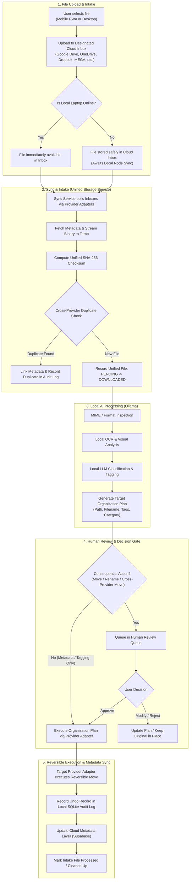
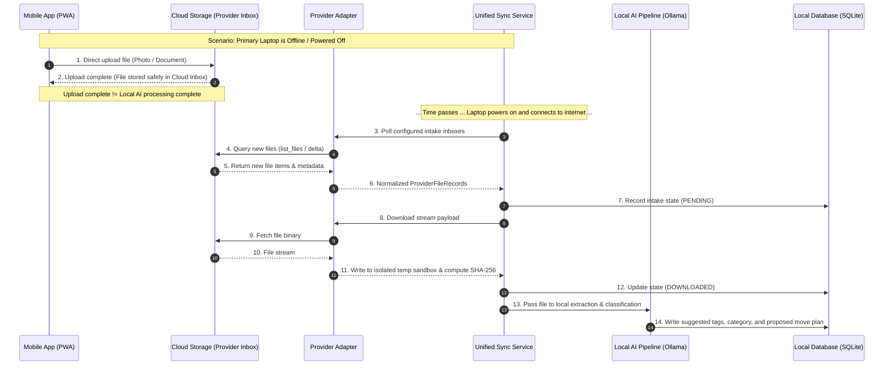

# SiloVault — Data Flow & File Lifecycle

This document defines the proposed end-to-end file lifecycle, synchronization patterns,
AI processing pipelines, and failure handling across **SiloVault's unified multi-cloud platform**.

For overall scope and definitions, see [PROJECT_OVERVIEW.md](PROJECT_OVERVIEW.md). For system topology, see [ARCHITECTURE.md](ARCHITECTURE.md). For safety rules, see [AGENTS.md](../AGENTS.md).

> [!IMPORTANT]
> **Status:** All workflows, state machines, and retry logic described in this document are **Proposed** or **Planned** designs. **The FastAPI backend skeleton (14 routes) and PWA frontend shell (6 views) exist**, but actual upload, synchronization, database workflows, provider adapters, and AI processing are **not implemented**. No application code or sync worker scripts are currently implemented.

---

## 1. End-to-End Multi-Cloud File Lifecycle Diagram

---

## 2. Offline Upload & Delayed Synchronization Diagram

---

## 3. Detailed Data Flow Stages

### 3.1 Multi-Provider File Upload
1. **User Action:** Mobile or desktop users select photos, videos, or documents to upload.
2. **Target Destination:** Files are uploaded to a designated inbox folder on a user-selected cloud provider (initial: **Google Drive Mobile Inbox**; planned: OneDrive, Dropbox, Box, and MEGA inboxes).
3. **Offline Tolerance:** If the primary processing laptop is offline, sleeping, or disconnected, upload completes directly to cloud storage without interruption.
4. **State Separation:** 
   - **Upload Completion:** File is securely preserved on the cloud provider.
   - **Processing Completion:** Occurs when the local AI node comes online, syncs via the appropriate adapter, runs AI inference, and presents organization suggestions.

### 3.2 Unified Synchronization & State Machine
The local sync engine coordinates polling across all connected provider adapters.

* **Unified Tracking States:**
  - `PENDING`: Detected in cloud inbox; registered in unified database queue.
  - `DOWNLOADING`: Local node is transferring file content to local temporary storage.
  - `DOWNLOADED`: File binary downloaded to sandbox temp folder and SHA-256 verified locally. *(For MEGA, ciphertext binary is decrypted locally using the user's decrypted node key in the sandbox before SHA-256 calculation and AI processing).*
  - `PROCESSING`: Active in local OCR, extraction, or classification pipeline.
  - `AWAITING_APPROVAL`: Proposed organization plan requires human confirmation.
  - `COMPLETED`: File successfully organized, audit logged, and metadata synced.
  - `FAILED`: Processing or network error encountered; isolated for retry or manual inspection.

* **Universal Deduplication:**
  - Compute a local cryptographic SHA-256 hash upon download (and local decryption for E2EE providers).
  - Compare hash against unified cross-provider database to detect identical files across different providers or accounts before invoking AI models.

### 3.3 Local AI Processing Pipeline
1. **Identification:** Inspect MIME type, file magic bytes, file size, and extension to select appropriate extraction routines.
2. **Metadata Extraction:** Extract EXIF data (for photos), document properties, author headers, and camera details.
3. **Local OCR Processing:** Extract raw text from images and PDF scans using a local OCR engine without cloud transmission.
4. **Local AI Inference (Ollama):**
   - Supply extracted text and metadata to a local model (e.g., Llama 3).
   - Generate suggested classification (e.g., `Financial/Receipts`), tags (e.g., `#groceries`, `#2026`), and proposed filename/path.
5. **Error & Quarantine Handling:** Corrupted or unparseable files enter `FAILED` state, are logged with detailed diagnostics, and remain intact in the cloud intake inbox for manual review.

### 3.4 Human Review & Approval Gate
* **Suggestion Generation:** AI processing emits a structured organization plan (suggested name, destination folder, tags, category).
* **Consequential Change Gate:**
  - **Minor Metadata / Tagging:** Can be auto-applied based on user-defined confidence thresholds.
  - **Consequential Actions (Moving, Renaming, Archiving, Deletion):** Placed in the Human Approval Queue. AI is strictly prohibited from executing irreversible changes without human consent.
* **User Controls:** The user may:
  - **Approve:** Execute proposed move/rename as planned.
  - **Modify:** Edit filename, target folder, or tags before approving.
  - **Reject:** Leave original file untouched in place.

### 3.5 Reversible Organization & Multi-Provider Moves
1. **Safe Move / Copy Execution:** The designated Provider Adapter executes the move using copy-and-verify patterns to prevent data loss.
2. **Original Preservation:** The intake inbox copy is only removed after the destination write is confirmed and verified.
3. **Audit History & Rollback:** Every executed action writes an undo record into local SQLite (storing provider, source path, target path, timestamp, and hash), supporting single-click rollback.

### 3.6 Metadata and Synchronization
* **Decoupled Architecture:**
  - **File Binaries:** Remain stored across cloud storage providers (Google Drive, OneDrive, Dropbox, Box, MEGA).
  - **Unified Metadata:** Maintained in local SQLite and synchronized with the Cloud Control Plane (Supabase).
* **Sync Coordination:** The Cloud Control Plane coordinates cross-device metadata without ever transmitting or storing raw file binaries.

---

## 4. Multi-Provider Failure Recovery Matrix

| Failure Scenario | System Impact | Proposed Recovery Behavior |
|---|---|---|
| **Laptop Offline** | Mobile uploads succeed; local AI processing paused. | Files remain safely in cloud provider inboxes. Sync auto-resumes when laptop reconnects. |
| **Internet Interrupted during Transfer** | File download or metadata sync halted. | Partial downloads discarded; state remains `PENDING` or `DOWNLOADING`. Retried on next sync cycle. |
| **Provider Rate Limiting (429)** | Provider adapter requests throttled. | Adapter reads `Retry-After` header and engages exponential backoff with jitter. Queue paused for that provider. |
| **Provider Token Expired (401)** | Adapter API calls rejected. | Adapter initiates non-interactive refresh token exchange. If refresh fails, user is prompted in UI to re-authenticate account. |
| **MEGA Decryption Failure / Missing Key** | Ciphertext payload cannot be decrypted locally. | File placed in `FAILED` queue with specific diagnostic note (`ENCRYPTION_KEY_UNAVAILABLE`). User prompted to provide/unlock master key. Original ciphertext preserved intact in MEGA inbox. |
| **Corrupted / Damaged File** | Local extraction or OCR fails. | File flagged as `FAILED` in processing queue. Preserved in inbox with audit note for user manual review. |
| **Local Ollama Unavailable** | AI inference queue stalls. | Sync service continues downloading files to `DOWNLOADED` state. AI queue waits until local Ollama service becomes reachable. |
| **Duplicate File Uploaded** | Redundant storage and processing risk. | Universal SHA-256 hash match detects duplicate across any provider. Prompts user or links metadata to existing file. |
