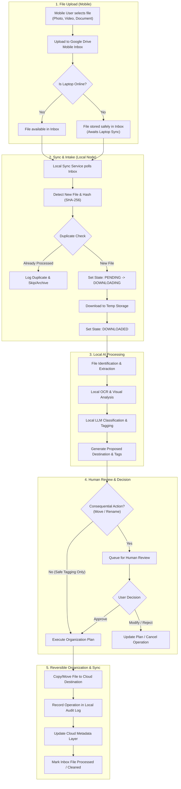
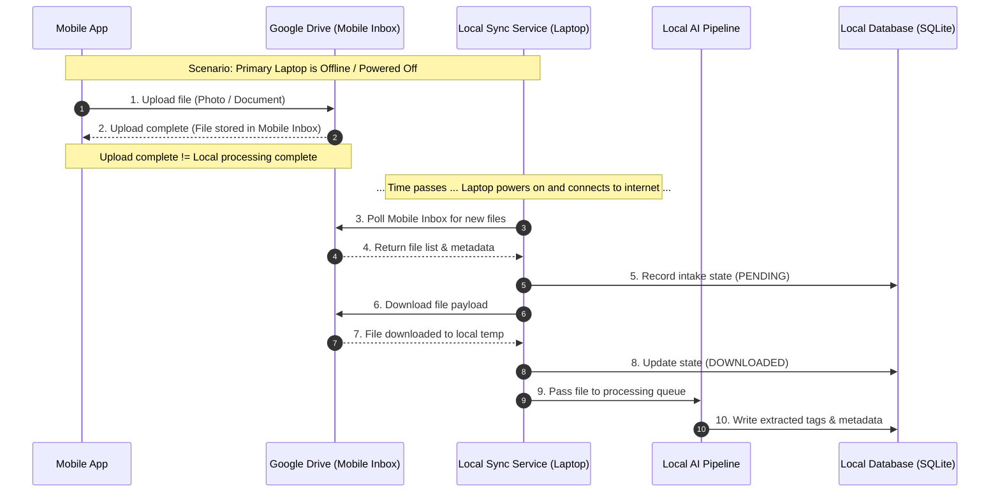

# SiloVault — Data Flow & File Lifecycle

This document defines the proposed end-to-end file lifecycle, synchronization patterns,
AI processing pipelines, and failure handling in **SiloVault**.

For overall scope and definitions, see [PROJECT_OVERVIEW.md](PROJECT_OVERVIEW.md). For system topology, see [ARCHITECTURE.md](ARCHITECTURE.md). For safety rules, see [AGENTS.md](../AGENTS.md).

> [!IMPORTANT]
> **Status:** All workflows, state machines, and retry logic described in this document are **Proposed** or **Planned** designs. **The FastAPI backend skeleton (14 routes) and PWA frontend shell (6 views) exist**, but actual upload, synchronization, database workflows, and AI processing are **not implemented**. No application code or sync scripts are currently implemented.

---

## 1. End-to-End File Lifecycle Diagram

---

## 2. Offline Upload & Delayed Synchronization Diagram

---

## 3. Detailed Data Flow Stages

### 3.1 File Upload
1. **User Action:** The mobile application lets the user capture or select photos, videos, or documents.
2. **Target Destination:** Uploads are written directly to a dedicated **Google Drive Mobile Inbox** directory.
3. **Offline Tolerance:** If the primary laptop is powered off, un-networked, or sleeping, the upload succeeds independently.
4. **State Separation:** 
   - **Upload Completion:** The file is securely stored on Google Drive.
   - **Processing Completion:** Occurs later when the local AI node syncs, inspects, processes, and organizes the file.

### 3.2 Synchronization & Queue Management (Proposed State Machine)
The local sync service runs on the primary laptop and monitors the cloud inbox.

* **Tracking States:**
  - `PENDING`: Detected in cloud inbox; registered in local database queue.
  - `DOWNLOADING`: Local node is actively transferring file content to local temporary storage.
  - `DOWNLOADED`: File binary downloaded and verified locally.
  - `PROCESSING`: Active in local OCR, extraction, or classification pipeline.
  - `AWAITING_APPROVAL`: Proposed organization action requires user sign-off.
  - `COMPLETED`: File successfully organized, logged, and metadata synced.
  - `FAILED`: Processing or transfer error encountered; isolated for retry or manual inspection.

* **Duplicate Detection (Proposed):**
  - Compute local cryptographic hash (e.g., SHA-256) of file content upon download.
  - Compare hash against local history database to detect re-uploaded or identical files before running AI inference.

### 3.3 Local Processing Pipeline
1. **Identification:** Inspect MIME type, file header, file size, and extension to route to appropriate extractors.
2. **Metadata Extraction:** Read EXIF data (for photos), document properties, creation dates, and camera metadata.
3. **OCR Processing:** Extract raw text from images and PDF scans using local OCR engine.
4. **Local AI Inference (Ollama):**
   - Provide extracted text/metadata to local LLM/vision model.
   - Generate suggested classification (e.g., `Financial/Receipts`), tags (e.g., `#groceries`, `#2026`), and proposed filename.
5. **Error & Corruption Handling:** Unsupported formats or corrupted files are set to `FAILED` state, logged in local audit history, and moved to a quarantine review list without crashing the service.

### 3.4 Human Review & Approval Workflow
* **Suggestion Generation:** AI processing emits a proposed organization plan (suggested name, destination folder, tags, category).
* **Consequential Change Gate:**
  - **Minor Metadata / Tagging:** Can be auto-applied based on user-defined rule confidence thresholds.
  - **Consequential Actions (Moving, Renaming, Archiving):** Require explicit user confirmation in the interface.
* **User Controls:** The user may:
  - **Approve:** Execute proposed move/rename as planned.
  - **Modify:** Edit suggested filename, target path, or tags before approving.
  - **Reject:** Leave original file in place or skip organization.

### 3.5 Organization & Reversibility
1. **Safe Move / Copy Execution:** Perform cloud move operations using copy-and-verify patterns where feasible to prevent data loss.
2. **Original File Preservation:** The original file in the Mobile Inbox is only cleaned up after successful move confirmation and local logging.
3. **Audit History & Rollback:** Every executed action writes an undoable operation record into local history (storing source path, destination path, timestamp, and hash), supporting future single-click rollback.

### 3.6 Metadata and Synchronization
* **Decoupling Content & Metadata:**
  - **File Bytes:** Live in Cloud Storage (Google Drive).
  - **File Metadata:** Live in Local SQLite and synchronized with the proposed Cloud Control Plane (Supabase).
* **Sync Coordination:** Cloud Control Plane receives metadata updates (tags, status, file locations) to keep mobile clients in sync without transmitting file binaries back and forth.

---

## 4. Failure Recovery Matrix

| Failure Scenario | System Impact | Proposed Recovery Behavior |
|---|---|---|
| **Laptop Offline** | Mobile uploads succeed; local AI processing paused. | Files remain in Google Drive Mobile Inbox. Processing auto-resumes when laptop sync service reconnects. |
| **Internet Interrupted during Sync** | File download or metadata sync halted. | Partial downloads discarded or resumed; state remains `PENDING` or `DOWNLOADING`. Retried on next sync cycle. |
| **Google Drive API Error / Rate Limit** | File move or list request fails. | Exponential backoff retry handler. Operation logged with error code; state set to `PENDING` or `FAILED`. |
| **Corrupted / Damaged File** | Local extraction or OCR fails. | File flagged as `FAILED` in processing queue. Preserved in inbox with audit note for user manual review. |
| **Local AI Engine Unavailable** | Inference queue stalls. | Sync service continues downloading files to `DOWNLOADED` state. AI queue waits until local engine is operational. |
| **Duplicate File Uploaded** | Risk of redundant processing/storage. | SHA-256 hash match against database detects duplicate. System prompts user or links metadata to existing file. |
