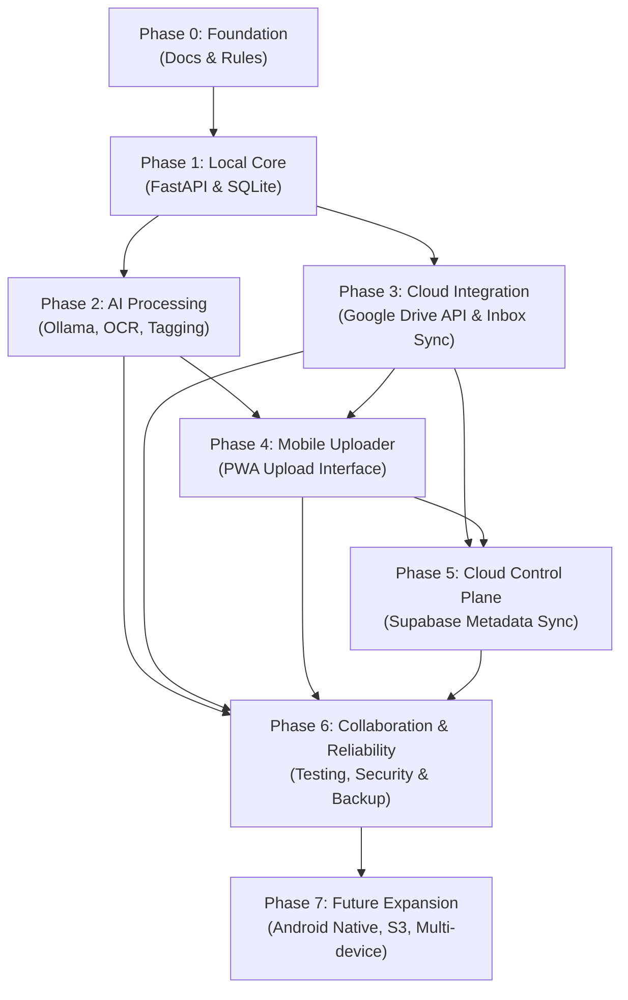

# SiloVault — Phased Development Roadmap

This document defines the proposed multi-phase development roadmap for **SiloVault**.

For overall scope and terminology, see [PROJECT_OVERVIEW.md](PROJECT_OVERVIEW.md). For structural design, see [ARCHITECTURE.md](ARCHITECTURE.md). For data movement, see [DATA_FLOW.md](DATA_FLOW.md). For security guidelines, see [SECURITY.md](SECURITY.md).

> [!NOTE]
> **Status:** This roadmap is a **Proposed Plan**. Except for Phase 0 foundation documentation and repository setup, no software phases are currently active or implemented.

---

## Roadmap Overview & Phase Dependencies

---

## Detailed Phase Specifications

### Phase 0 — Foundation & Governance
* **Status:** **IN PROGRESS / NEAR COMPLETION** (Foundation docs established)
* **Objective:** Establish project rules, architectural blueprints, documentation standards, and repository safety boundaries before writing application code.
* **Main Features:**
  - Standardized repository layout and strict `.gitignore` rules.
  - Development guidelines (`AGENTS.md`) for human and AI pair programming.
  - Architectural blueprints (`PROJECT_OVERVIEW`, `ARCHITECTURE`, `DATA_FLOW`, `SECURITY`).
  - Draft initial API contract principles (`API_CONTRACT.md`).
* **Dependencies:** None.
* **Expected Deliverables:** Clean root repository containing verified governance files and markdown documentation.
* **Completion Criteria:** All core foundation documents created, reviewed, and committed to GitHub without application source code or tracking errors.

---

### Phase 1 — Local Core Engine
* **Status:** **PLANNED**
* **Objective:** Build a minimal, functional local backend service on the Windows laptop capable of managing local files, SQLite metadata, and operational history.
* **Main Features:**
  - `FastAPI` application server running locally on `127.0.0.1`.
  - `SQLite` database schema for tracking local file states, hashes (SHA-256), and audit logs.
  - Local file scanner, MIME/extension identification, and file path indexer.
  - Basic file management engine (safe copy, rename, reversible move abstractions).
  - Local operational history log and rollback registry.
* **Dependencies:** Phase 0.
* **Expected Deliverables:** Executable local backend module with database migration scripts and local CLI/API test scripts.
* **Completion Criteria:** Local backend starts, creates local SQLite tables, indexes sample local directories, and logs file moves with 100% test coverage for path traversal and rollbacks.

---

### Phase 2 — Local AI Processing Pipeline
* **Status:** **PLANNED**
* **Objective:** Integrate local AI models for document OCR, image analysis, automatic classification, tagging, and structured human approval queues.
* **Main Features:**
  - Local `Ollama` client integration for offline inference.
  - Local OCR engine (e.g., Tesseract or local vision model) for document and image text extraction.
  - Prompt formatting engine enforcing structured JSON output for categories and tags.
  - Human Approval Queue logic for flagging consequential file operations.
  - Quarantining pipeline for unreadable or corrupted files.
* **Dependencies:** Phase 1.
* **Expected Deliverables:** Modular AI processing pipeline, prompt templates, and approval queue APIs.
* **Completion Criteria:** Local backend successfully processes local sample PDFs/images, extracts text via OCR, receives JSON tags from Ollama, and queues consequential moves for approval.

---

### Phase 3 — Cloud Storage & Inbox Synchronization
* **Status:** **PLANNED**
* **Objective:** Establish secure Google Drive API integration to poll a dedicated Mobile Inbox and synchronize files to the local node.
* **Main Features:**
  - Google Drive OAuth 2.0 authentication integration with secure local token storage.
  - Mobile Inbox directory monitoring service (polling / webhook triggers).
  - Synchronization engine supporting `PENDING`, `DOWNLOADING`, `DOWNLOADED`, `COMPLETED`, `FAILED` state transitions.
  - SHA-256 duplicate detection before download.
  - Exponential backoff retry logic for cloud API rate limits and connection drops.
* **Dependencies:** Phase 1 (Local Core).
* **Expected Deliverables:** Sync worker service, Google Drive client wrapper, and sync state transition logger.
* **Completion Criteria:** Local sync engine automatically detects new files added manually to a Google Drive inbox folder, downloads them to local temp storage, and handles simulated network drops cleanly.

---

### Phase 4 — Mobile Uploader Interface
* **Status:** **PLANNED**
* **Objective:** Create a lightweight, offline-tolerant Progressive Web App (PWA) allowing mobile users to upload photos, videos, and documents to the Google Drive Mobile Inbox.
* **Main Features:**
  - Responsive, lightweight PWA upload interface for iOS/Android browsers.
  - Camera capture and document file picker integration.
  - Direct upload stream targeting Google Drive Mobile Inbox.
  - Offline upload queueing in browser storage (syncs when mobile device gains internet connection).
  - Upload progress indicators and processing status tracking.
* **Dependencies:** Phase 3.
* **Expected Deliverables:** Mobile PWA client codebase, static deployment configuration, and mobile upload test guidelines.
* **Completion Criteria:** Mobile user can open PWA on a smartphone, select or snap a photo, and upload it to Google Drive Mobile Inbox even while the primary laptop is turned off.

---

### Phase 5 — Cloud Control Plane & Metadata Sync
* **Status:** **PROPOSED**
* **Objective:** Integrate a lightweight cloud backend (evaluating `Supabase`) to manage user sessions and synchronize metadata across devices.
* **Main Features:**
  - Supabase Auth / OAuth session coordination across Mobile PWA and Local Node.
  - Cloud metadata database syncing file categories, tags, and activity status (without file binaries).
  - Row Level Security (RLS) setup for multi-device/user isolation.
  - Cross-device activity logging and real-time status updates on mobile.
* **Dependencies:** Phase 3 & Phase 4.
* **Expected Deliverables:** Supabase configuration, cloud database migration scripts, and metadata sync adapter.
* **Completion Criteria:** Mobile PWA displays real-time status (e.g., "AI Processing...", "Awaiting Approval") for uploaded files by reading metadata synced from the local node via Supabase.

---

### Phase 6 — Integration, Reliability & Security Hardening
* **Status:** **PLANNED**
* **Objective:** Consolidate features across both developers, conduct end-to-end security audits, implement automated test suites, and optimize performance.
* **Main Features:**
  - Integration of two-developer feature branches into GitHub main branch.
  - Full end-to-end integration tests (Upload → Sync → Local AI → Approval → Cloud Move).
  - Automated security audit (`pip-audit`, dependency review, path traversal verification).
  - Backup & disaster recovery procedures for SQLite metadata and operation logs.
  - Performance tuning for local OCR and Ollama inference batches.
* **Dependencies:** Phases 1 through 5.
* **Expected Deliverables:** Comprehensive test suite, security audit report, and disaster recovery guide.
* **Completion Criteria:** System passes full end-to-end pipeline tests without error, handles simulated failure modes gracefully, and achieves full pass rating on security audit scripts.

---

### Phase 7 — Future Expansion (Post-v1.0)
* **Status:** **FUTURE POSSIBILTY**
* **Objective:** Explore broader device support, alternative cloud providers, and advanced AI features after v1.0 stability.
* **Main Features:**
  - Native Android application with background auto-upload sync.
  - Support for additional cloud storage backends (AWS S3, Microsoft OneDrive, Dropbox).
  - Support for secondary local nodes or desktop companion apps.
  - Advanced local AI features: local vector database (RAG over user documents), semantic file search, automated document summarization.
* **Dependencies:** Successful v1.0 release (Phases 0–6).
* **Expected Deliverables:** Future feature proposals and experimental branch specifications.
* **Completion Criteria:** Evaluated on a case-by-case basis as requested by project maintainers.
