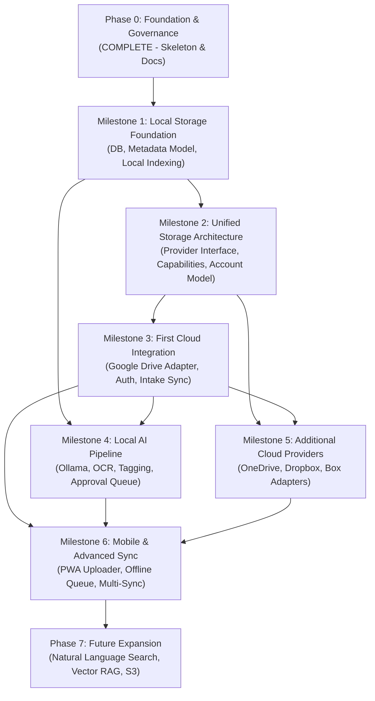

# SiloVault — Phased Development Roadmap

This document defines the proposed multi-phase development roadmap for **SiloVault** as it evolves into a **privacy-focused, AI-powered unified cloud storage management platform**.

For overall scope and terminology, see [PROJECT_OVERVIEW.md](PROJECT_OVERVIEW.md). For structural design, see [ARCHITECTURE.md](ARCHITECTURE.md). For data movement, see [DATA_FLOW.md](DATA_FLOW.md). For security guidelines, see [SECURITY.md](SECURITY.md).

> [!NOTE]
> **Status:** This roadmap is a **Proposed Plan**. **Phase 0 (Foundation) is complete** — documentation, repository setup, and an application skeleton (FastAPI backend with routes, PWA frontend shell with 6 views, test scaffolding) are in place. All non-health endpoints are placeholder stubs. Subsequent milestones are scheduled for implementation beginning in December 2026.

---

## Roadmap Overview & Milestone Dependencies

---

## Detailed Milestone Specifications

### Phase 0 — Foundation & Governance
* **Status:** **COMPLETE**
* **Objective:** Establish repository safety, architectural blueprints, development guidelines, collaboration workflows, and a runnable application skeleton.
* **Deliverables:** Clean repository layout, `.gitignore`, `AGENTS.md`, `README.md`, core documentation (`docs/`), FastAPI backend with 14 registered routes, PWA frontend shell with 6 views, and 6 passing tests.

---

### Milestone 1 — Local Storage Foundation
* **Status:** **COMPLETE**
* **Objective:** Build a robust, persistence-backed local foundation capable of tracking files, schemas, and operational history without cloud dependencies.
* **Key Capabilities:**
  - SQLAlchemy models and SQLite database initialization (`silo_vault.db`).
  - Unified file metadata model (`UnifiedFileRecord`) tracking filename, logical path, MIME type, size, SHA-256 hash, and timestamps.
  - Safe local path resolution and traversal sanitization (preventing `../` attacks).
  - Real file registration and listing endpoints (`GET /api/v1/files`, `GET /api/v1/files/{file_id}`).
  - Dynamic file listing in the PWA frontend dashboard replacing placeholder text.
  - **Activity History** (`GET /api/v1/activity`) recording every successful upload, download, and delete with paginated filtering and newest-first ordering.
  - Overview "Recent Activity" panel wired to the activity API; dashboards and uploads refresh automatically after each operation.
* **Implemented so far (M1 tasks 1–7):**
  - `UnifiedFileRecord` model, `backend/database.py` session management, and `silo_vault.db` initialization.
  - Real file endpoints: `POST /api/v1/uploads`, `GET /api/v1/files`, `GET /api/v1/files/{file_id}`, `GET /api/v1/files/{file_id}/download`, `DELETE /api/v1/files/{file_id}` (quarantine-based safe deletion with rollback recovery).
  - Activity History endpoint: `GET /api/v1/activity` (pagination, `action_type` filter, deterministic newest-first ordering via `timestamp DESC, id DESC`). Activity records are written for every successful upload, download, and delete; failed operations produce no record.
  - Frontend Files, Uploads, Dashboard, and Activity views wired to the real backend (upload queue, drag-and-drop, download/delete actions, load-more pagination on the dedicated Activity page, automatic refresh of Recent Activity on the Overview after any operation).
  - **Alembic** database migrations: baseline revision `b436c12118f9` for `unified_file_records`; activity revision `4ef0d0cc89e5` creating `activity_records` with three indexes (`timestamp`, `action_type`, `provider`); existing development database stamped at baseline without data loss; explicit `alembic upgrade head` workflow (migrations are never run automatically on app startup).
  - Test suite: **93 tests passing (1 platform-specific skip on Windows)** covering database, uploads, files, downloads, deletion rollback, Alembic migrations (including the new activity table), and activity history behavior.
* **Known limitations at M1 completion:**
  - **Activity History rollback** (`POST /api/v1/activity/rollback/{id}`) is a **placeholder** — it returns a constant message. Reversible operations require provider adapters that do not yet exist.
  - **Cloud provider integrations (Google Drive, OneDrive, Dropbox, Box, MEGA)** are **planned but not implemented**. The only operational storage today is local disk under the configured uploads directory.
  - **AI processing (Ollama, OCR, tagging, classification)**, the **approval queue**, and **cross-provider sync** are all **planned for future milestones** and have no working implementation yet.
* **Remaining for M1:** None — milestone complete.
* **Dependencies & Prerequisites:** Phase 0 foundation skeleton.
* **Deliverables:** `backend/database.py` session management, `backend/models/file.py`, `backend/schemas/file.py`, populated `/files` endpoints, updated dashboard view.
* **Relevant Areas:**
  - Backend: `backend/database.py`, `backend/models/`, `backend/schemas/`, `backend/api/v1/endpoints/files.py`.
  - Frontend: `frontend/js/files.js`, `frontend/js/dashboard.js`, `frontend/js/api.js`.
  - Docs: `docs/API_CONTRACT.md`.
* **Suggested Tests:**
  - Unit tests for database table creation and CRUD operations.
  - Path traversal security tests (malicious filenames and paths).
  - API endpoint integration tests for `GET /api/v1/files` returning real JSON lists.
* **Risks & Decisions:**
  - *Decision:* Synchronous SQLite vs `aiosqlite` with async SQLAlchemy sessions.
  - *Risk:* Concurrent write lock contention in SQLite during bulk indexing.
* **Suggested Ownership:** Developer 1 (Windows / Backend Core).

---

### Milestone 2 — Unified Storage Architecture
* **Status:** **PLANNED**
* **Objective:** Design and implement the provider-independent storage layer that allows SiloVault to connect multiple cloud providers through a common contract.
* **Key Capabilities:**
  - Abstract base class `StorageAdapter` defining standard methods (`authenticate`, `list_files`, `get_metadata`, `upload`, `download`, `rename`, `move`, `delete`, `check_sync_status`).
  - Provider capability model declaring feature flags (`supports_delta_sync`, `supports_chunked_upload`, `addressing_mode`).
  - Account and connection manager in the backend for storing encrypted provider credentials and tokens locally.
  - Virtual multi-provider namespace in `UnifiedStorageService`.
  - Standardized error handling and mapping (`NormalizedStorageError`, rate-limit handling).
* **Dependencies & Prerequisites:** Milestone 1 (data models for storing provider accounts and references).
* **Deliverables:** `backend/storage/base.py`, `backend/storage/capabilities.py`, `backend/storage/service.py`, `backend/models/provider_account.py`.
* **Relevant Areas:**
  - Backend: `backend/storage/`, `backend/models/`, `backend/schemas/`.
  - Frontend: `frontend/js/settings.js` (provider accounts view).
  - Docs: `docs/ARCHITECTURE.md`.
* **Suggested Tests:**
  - Mock adapter unit tests verifying interface compliance and capability flags.
  - Error normalization tests for HTTP 429, 401, 404, 503 translations.
  - Multi-account registry isolation tests.
* **Risks & Decisions:**
  - *Decision:* Key management strategy for encrypting stored OAuth refresh tokens on disk.
  - *Decision:* Virtual path routing syntax (e.g., `/{provider}/{account_id}/path`).
* **Suggested Ownership:** Developer 2 (macOS / Architecture & Storage Abstractions).

---

### Milestone 3 — First Cloud Integration: Google Drive
* **Status:** **PLANNED**
* **Objective:** Implement the first concrete cloud storage adapter using the Google Drive API, enabling real cloud file ingestion and management.
* **Key Capabilities:**
  - Concrete `GoogleDriveAdapter` implementing `StorageAdapter`.
  - OAuth 2.0 PKCE / loopback flow for developer authentication with token refresh.
  - Mobile Inbox folder monitoring and intake polling.
  - Resumable file upload and streaming download.
  - Reversible file moves and rename operations within Google Drive.
  - Exponential backoff retry handler for Google Drive API rate limits.
* **Dependencies & Prerequisites:** Milestone 2 (Provider Adapter Interface).
* **Deliverables:** `backend/storage/google_drive.py`, OAuth credentials configuration, functional sync polling worker.
* **Relevant Areas:**
  - Backend: `backend/storage/google_drive.py`, `backend/api/v1/endpoints/sync.py`, `backend/config.py`.
  - Frontend: `frontend/js/sync.js`, `frontend/js/settings.js`.
  - Docs: `docs/API_CONTRACT.md`, `docs/DATA_FLOW.md`.
* **Suggested Tests:**
  - Mock Google Drive API tests for folder listing, pagination, and download streaming.
  - OAuth token refresh flow tests.
  - Rate-limit backoff simulation tests.
* **Risks & Decisions:**
  - *Decision:* Google Drive API scopes (full drive vs restricted `drive.file` / app-folder scope).
  - *Risk:* API quota consumption during polling loops (mitigated by using `Changes.list` with page tokens).
* **Suggested Ownership:** Developer 1 (Windows / Cloud Sync Worker).

---

### Milestone 4 — Local AI Processing Pipeline
* **Status:** **PLANNED**
* **Objective:** Connect the local Ollama AI engine and local OCR to classify files, extract metadata, generate tags, and route consequential actions through human review.
* **Key Capabilities:**
  - Local HTTP client connecting to `http://127.0.0.1:11434` (Ollama) with configurable model (`llama3:8b`).
  - Local OCR extraction for PDFs and images.
  - Structured prompt engine constraining Ollama outputs to strict JSON schemas.
  - Duplicate detection engine comparing universal SHA-256 hashes.
  - Human Approval Queue (`GET /api/v1/approvals/pending`, `POST /api/v1/approvals/{approval_id}/action`).
  - Approval UI in PWA for reviewing, editing, approving, or rejecting proposed renames/moves.
* **Dependencies & Prerequisites:** Milestone 1 (file records) and Milestone 3 (real file payloads downloaded to intake temp sandbox).
* **Deliverables:** `backend/ai/ollama_client.py`, `backend/ai/ocr.py`, `backend/ai/pipeline.py`, populated `/ai` and `/approvals` endpoints.
* **Relevant Areas:**
  - Backend: `backend/ai/`, `backend/api/v1/endpoints/processing.py`, `backend/api/v1/endpoints/review.py`.
  - Frontend: `frontend/js/dashboard.js`, `frontend/js/api.js` (approval actions).
  - Docs: `docs/SECURITY.md`.
* **Suggested Tests:**
  - Mock Ollama response parsing tests ensuring JSON schema validation.
  - Prompt injection isolation tests (adversarial text inside documents).
  - Approval queue execution and rollback tests.
* **Risks & Decisions:**
  - *Risk:* Ollama inference latency on large documents (mitigated by asynchronous background queue).
  - *Decision:* OCR engine selection (Tesseract binary vs lightweight local Python OCR).
* **Suggested Ownership:** Developer 2 (macOS / AI Pipeline & Approval UX).

---

### Milestone 5 — Additional Cloud Providers (OneDrive, Dropbox, Box, MEGA)
* **Status:** **PLANNED / PROPOSED**
* **Objective:** Expand the multi-cloud platform by implementing adapters for Microsoft OneDrive, Dropbox, Box, and MEGA based on the Milestone 2 architecture.
* **Key Capabilities:**
  - `OneDriveAdapter` utilizing Microsoft Graph API (upload sessions, delta queries).
  - `DropboxAdapter` using Dropbox API v2 (`/files/list_folder/continue`, content hashes).
  - `BoxAdapter` utilizing Box API (chunked upload, enterprise metadata).
  - `MegaAdapter` integrating MEGA's client-side zero-knowledge E2EE architecture (scheduled as a later provider integration once standard OAuth adapters are stable).
  - Cross-provider browsing and search in the PWA dashboard.
  - Cross-provider duplicate detection using unified SHA-256 hashes.
* **Dependencies & Prerequisites:** Milestone 2 (Adapter interface), Milestone 3 (lessons learned from Google Drive adapter), and a dedicated cryptographic/licensing spike for MEGA.
* **Deliverables:** `backend/storage/onedrive.py`, `backend/storage/dropbox.py`, `backend/storage/box.py`, and `backend/storage/mega.py` (with an optional isolated process boundary recommended for security and reliability, not required by license).
* **Relevant Areas:**
  - Backend: `backend/storage/`, `backend/api/v1/endpoints/files.py`.
  - Frontend: `frontend/js/files.js`, `frontend/js/settings.js`.
  - Docs: `docs/ARCHITECTURE.md`.
* **Suggested Tests:**
  - Adapter contract compliance test suite run against each new provider mock.
  - Multi-provider unified file search tests.
  - Resumable upload session tests across varying chunk sizes.
  - Local decryption verification test for MEGA ciphertext payload streams before SHA-256 calculation.
* **Risks & Decisions:**
  - *Risk:* Maintaining multiple cloud developer apps and OAuth verification requirements.
  - *Decision:* Priority order of adapters (recommended sequence: OneDrive first, then Dropbox, then Box, followed by MEGA after the E2EE adapter spike).
  - *MEGA Architecture Risk:* The official MEGA SDK is licensed under **BSD 2-Clause "Simplified"** (permissive, no copyleft), but MEGAcmd and third-party dependencies may carry other licenses (e.g., AGPLv3) and require individual audit. An official API key from MEGA Ltd. is required for production use. *Recommended:* Evaluate running MEGA operations in an isolated CLI subprocess (`MEGAcmd`) or separate micro-process boundary as a **security and reliability** measure (not a licensing requirement), to limit crash blast radius and simplify credential handling.
  - *MEGA Key Management:* Establishing a secure workflow for master key / password derivation without ever storing plaintext passwords or exposing keys to the frontend.
* **Suggested Ownership:** Shared / Decoupled (Developer 1 on OneDrive; Developer 2 on Dropbox & Box; Joint spike on MEGA).

---

### Milestone 6 — Mobile Client & Advanced Synchronization
* **Status:** **PLANNED**
* **Objective:** Deliver an offline-friendly mobile PWA experience for capturing, uploading, and monitoring files across connected cloud storage inboxes.
* **Key Capabilities:**
  - Responsive mobile PWA with camera capture and native file picker integration.
  - Offline upload queue backed by IndexedDB.
  - Direct upload streaming to target cloud provider inboxes.
  - Real-time or polled processing status indicators ("Uploaded", "Processing", "Awaiting Approval").
  - Multi-provider conflict resolution (handling remote renames vs local organization moves).
* **Dependencies & Prerequisites:** Milestone 3 (cloud intake) and Milestone 4 (approval workflows).
* **Deliverables:** Enhanced `frontend/` PWA application, service worker offline caching, upload queue worker.
* **Relevant Areas:**
  - Frontend: `frontend/js/uploads.js`, `frontend/service-worker.js`, `frontend/manifest.json`.
  - Backend: `backend/api/v1/endpoints/uploads.py`, `backend/api/v1/endpoints/sync.py`.
  - Docs: `docs/DATA_FLOW.md`.
* **Suggested Tests:**
  - Service worker offline cache verification.
  - IndexedDB upload queue retry tests on network reconnect.
  - End-to-end upload to intake inbox simulation.
* **Risks & Decisions:**
  - *Risk:* Browser background execution limits on mobile OS (iOS Safari background timeouts).
  - *Decision:* Mobile direct upload vs relaying through local node when local node is on same Wi-Fi.
* **Suggested Ownership:** Developer 2 (Frontend / Mobile PWA Focus).

---

### Phase 7 — Future Expansion (Post-v1.0)
* **Status:** **FUTURE POSSIBILITY**
* **Objective:** Advanced intelligence, storage providers, and platform extensions after v1.0 stability.
* **Main Features:**
  - Natural-language file search across all providers using local embeddings (e.g., ChromaDB/Qdrant + Ollama).
  - Semantic document querying and automated summarization.
  - Additional cloud providers: AWS S3, Nextcloud, WebDAV.
  - Native Android application with background auto-upload synchronization.
* **Dependencies:** Successful completion of Milestones 1–6.

---

## Developer Ownership & Collaboration Summary

| Milestone | Primary Owner | Secondary Reviewer | Primary Focus Area |
|---|---|---|---|
| **M1: Local Storage Foundation** | Developer 1 | Developer 2 | SQLite models, path sanitization, file indexing |
| **M2: Unified Storage Architecture** | Developer 2 | Developer 1 | StorageAdapter contract, capability flags, account model |
| **M3: First Cloud Integration (Google Drive)** | Developer 1 | Developer 2 | Google Drive API, OAuth token storage, inbox polling |
| **M4: Local AI Processing Pipeline** | Developer 2 | Developer 1 | Ollama client, prompt schemas, OCR, approval UI |
| **M5: Additional Providers (OneDrive/Dropbox/Box/MEGA)** | Split | Reciprocal | OneDrive (Dev 1), Dropbox & Box (Dev 2), Joint spike (MEGA) |
| **M6: Mobile & Advanced Sync** | Developer 2 | Developer 1 | PWA upload queue, offline resilience, conflict handling |

---

## Key Architectural Decisions Requiring Alignment

Before starting December implementation, the two developers must formally agree on:

1. **Async vs Sync Database Layer:** Whether to use SQLAlchemy 2.0 with synchronous SQLite or asynchronous `aiosqlite`.
2. **Local Credential Storage:** Mechanism for storing cloud OAuth refresh tokens and MEGA credentials securely on disk (e.g., OS keyring vs AES-GCM encrypted local store with user passphrase).
3. **Provider Priority & Roadmap Sequence:** Confirming Google Drive as initial target in M3, followed by OneDrive, Dropbox, and Box in M5, with MEGA scheduled as a subsequent E2EE integration spike.
4. **Approval Action Schema:** Harmonizing `POST /api/v1/approvals/{id}/action` payload between backend expectation and frontend submission.
